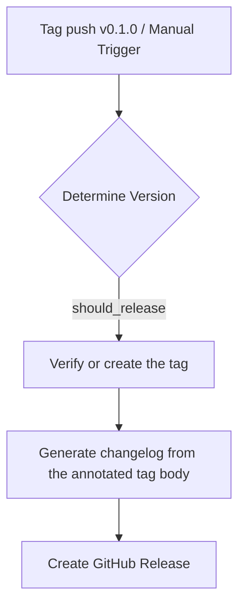

# Release Workflow Guide

This document explains how `release.cli.yaml` works and how to use it.

## What ships where

Every product artifact is an npm package, published by `release.npm-libs.yaml` on version tags:

- `@stigmer/cli` — the `stigmer` command itself.
- `@stigmer/server-slim` (+ its per-platform native packages) — the server the CLI acquires into `~/.stigmer/runtimes/<version>/` on first `stigmer up`.
- `@stigmer/server` — the same server as a composable library (`composeServer`, the extension registry, the driver seams), pinned by exact version by compositions such as the Stigmer Cloud control plane. Published by `publish-server` through `scripts/publish-standalone.mjs`, the sequence `@stigmer/runner` uses: stamp, pin the workspace-lib `file:` links to the release version, consumer-install smoke, publish.
- `@stigmer/enterprise` — Stigmer Enterprise (`ee/server`, under the Stigmer Enterprise License in `ee/LICENSE`, which its tarball carries), in lockstep with `@stigmer/server`: the same version on the same train. Published by `publish-enterprise`, which needs `publish-server` so Enterprise never ships at a version whose server failed to, through the same `scripts/publish-standalone.mjs` sequence; its `file:` links pin to that release's `@stigmer/server`, `@stigmer/apis` and `@stigmer/outbound`.
- The runner and library packages.

Beside the npm packages, the same workflow pushes the container images to GHCR, each smoked on native runners of both architectures before `latest` moves to a stable release. Among them, `ghcr.io/stigmer/stigmer-server-ee` is Stigmer Enterprise as a server image: the server image's Dockerfile over a slim tree bundled from `ee/server`'s entry, with the console. `stage-enterprise-image-trees` bundles and verifies the two trees, `publish-enterprise-image` pushes the version tag once `publish-enterprise` has published the package, `smoke-enterprise-image-amd64` and `-arm64` run `ee/server/scripts/smoke-image.mjs` on the pushed tag, and `promote-enterprise-image-latest` moves `latest`.

`release.cli.yaml` no longer builds or attaches any binaries: the Go `stigmer-server` tarballs it used to cross-compile for three platforms retired with the Go server. What remains is the GitHub Release itself.

## What release.cli.yaml does

1. **Determine version** — a `v*` tag push releases that tag; a manual dispatch with a version + "Create a release" does the same; anything else is a no-op.
2. **Verify tag exists** — tag pushes already have it; manual dispatch creates and pushes the annotated tag.
3. **Generate changelog** — the annotated tag body (curated by `@release-stigmer-oss`) becomes the release notes, prefixed with install instructions; falls back to `git log` when the tag carries no body.
4. **Create GitHub Release** — notes only, no assets.

## Creating a release

Use the repo's `@release-stigmer-oss` action rule: it curates the annotated tag with rich release notes and pushes it, which triggers this workflow. Manual path: GitHub Actions → "release.cli" → "Run workflow" with a version and "Create a release" = `true`.

## Version numbering

Semantic versioning, `MAJOR.MINOR.PATCH`. The CLI, server-slim, runner, and proto packages all publish the same version per release — the CLI pins its runtime acquisitions to its own version, so the stack stays in lockstep.

Versions run on one 0.x line whose first release is `v0.1.0`. `make release` tags the next version from the newest stable `v*` tag (`bump=patch|minor|major`), or `v0.1.0` while there is none, whatever `bump=` says; `scripts/lib/line-base.mjs` is that rule, and the dev lane takes its base from it too, so until `v0.1.0` every dev build is `0.1.0-dev.<14-digit UTC stamp>.g<12-character commit>` ([Dev Publishing Guide](dev-publishing.md)). The upgrade rehearsal starts from the newest earlier release npm does not mark deprecated; for the line's first release there is none, and it says so and passes.

## Homebrew

The Homebrew tap (`stigmer/tap/stigmer`) is deliberately NOT bumped by this workflow: Homebrew runs formula npm installs with `--min-release-age=1`, which rejects same-day `@stigmer/*` versions for ~24h (stigmer/stigmer#210). `reconcile-homebrew.yaml` bumps the tap on a schedule once the packages are old enough.
