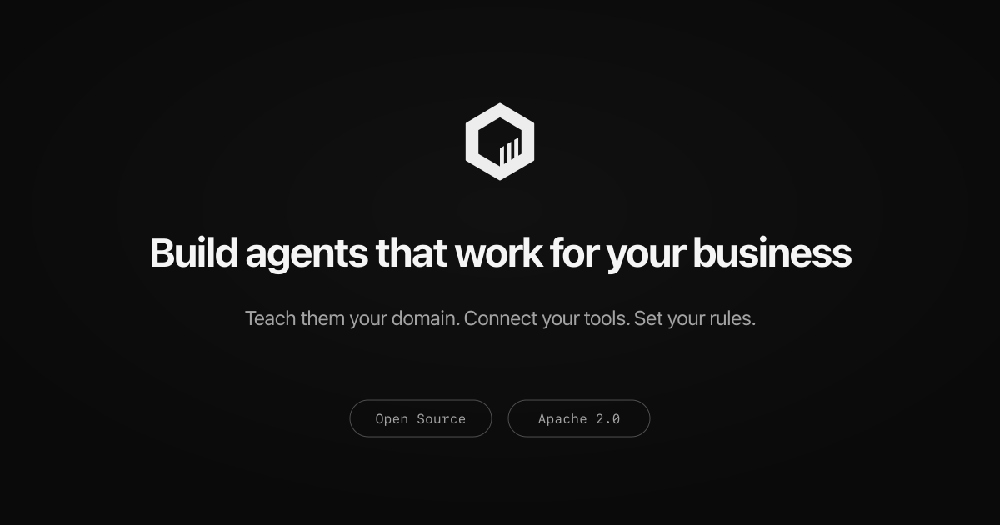

<div align="center">
  <a href="https://stigmer.ai">
    
  </a>
</div>

<br/>

# Stigmer

**The open-source backend for the agents in your product.** It runs behind
your app, the way your database does. Each of your customers gets an agent with
its own computer, one that works on a job for hours, asks before acting and
keeps their data apart from every other customer's.

Run it yourself on a laptop, one server or Kubernetes, or use Stigmer Cloud.
Agents run on your own model provider key.

[](LICENSE)
[](https://discord.com/invite/EtANnfsJ8B)
[](https://github.com/stigmer/stigmer/stargazers)

## Quick start

An accounting product's customer uploads a ledger, and an agent hands back a
variance report as a file:

```bash
brew install stigmer/tap/stigmer
export ANTHROPIC_API_KEY=<your Anthropic API key>
stigmer up
curl -fsSLO https://raw.githubusercontent.com/stigmer/stigmer/main/examples/variance-report/variance-reporter.yaml
curl -fsSLO https://raw.githubusercontent.com/stigmer/stigmer/main/examples/variance-report/ledger.csv
stigmer apply -f variance-reporter.yaml
stigmer run variance-reporter --attach ledger.csv --download ./out -m "Review this quarter's ledger."
cat out/variance-report.md
```

The customer's ledger went in, and their report came back as a file in `./out`,
written by the agent. [Your first agent job](https://stigmer.ai/docs/getting-started/quickstart)
walks through each step, and
[Do the same job from your app](https://stigmer.ai/docs/getting-started/call-from-your-app)
starts it from your own code.

<details>
<summary>Other install methods</summary>

```bash
# Shell script (macOS/Linux) — no prerequisites, bundles its own Node.js runtime
curl -fsSL https://stigmer.ai/install.sh | sh

# npm (requires Node.js >= 22.13)
npm install -g @stigmer/cli

# From source
git clone https://github.com/stigmer/stigmer.git
cd stigmer && make setup && npm install && make local
```

</details>

## What is Stigmer?

Your app calls Stigmer, and Stigmer runs the agent on your model provider. Each
of your customers gets an agent that takes what they hand it, works through it
on a computer of its own, and hands back the result. You build the feature, not
the machinery.

Bring the plugins you already have: install the Claude Code, Cursor or Codex
plugins your team uses, and a plugin carries skills, hooks, subagents and the
[MCP](https://modelcontextprotocol.io) servers that connect agents to your
systems. Agents discover the tools and Stigmer handles execution sandboxing.

## Core concepts

- [Agent](https://stigmer.ai/docs/concepts/agents): the definition of a job,
  what it does and how, written as YAML.
- [Environment](https://stigmer.ai/docs/concepts/environments): the agent's
  computer, what is installed on it and what it may reach.
- [Session](https://stigmer.ai/docs/concepts/sessions): one job, with its
  conversation, its events and the [files](https://stigmer.ai/docs/concepts/files)
  that go in and come back.
- [Vaults](https://stigmer.ai/docs/concepts/vaults) and
  [model keys](https://stigmer.ai/docs/guides/integrations/model-provider-keys):
  where your keys and your customers' keys live.
- Ways to reach an agent: [channels](https://stigmer.ai/docs/concepts/channels),
  [routines](https://stigmer.ai/docs/concepts/routines),
  [the API](https://stigmer.ai/docs/getting-started/call-from-your-app) and
  [your app's UI](https://stigmer.ai/docs/getting-started/embed-agent).
- [Access](https://stigmer.ai/docs/concepts/sharing-and-access) and
  [organizations](https://stigmer.ai/docs/concepts/organizations): who may use
  what, and how each customer is kept apart.

Stigmer also ships its own MCP server, which exposes Stigmer's resources to
AI-powered IDEs:

```bash
stigmer mcp-server
```

See [mcp-server/README.md](mcp-server/README.md) for IDE configuration (Cursor, Claude Desktop, VS Code, Windsurf).

## SDKs

| SDK | Install | Reference |
|-----|---------|-----------|
| **Go** | `go get go.stigmer.ai/sdk` | [Reference](https://stigmer.ai/docs/sdk/go) |
| **TypeScript** | `npm install @stigmer/client` | [Reference](https://stigmer.ai/docs/sdk/typescript) |
| **Python** | `pip install stigmer-sdk` | [Reference](https://stigmer.ai/docs/sdk/python) |
| **Java** | Maven: `ai.stigmer:stigmer-sdk` | [Reference](https://stigmer.ai/docs/sdk/java) |
| **React** | `npm install @stigmer/react-sdk` | [Reference](https://stigmer.ai/docs/sdk/react) |
| **Ink** | `npm install @stigmer/ink-ui` | [Reference](https://stigmer.ai/docs/sdk/ink) |

The Go, TypeScript, Python, and Java SDKs provide typed API clients for every Stigmer resource. The React SDK renders agent UIs — session composers, message threads, and approval views. The Ink SDK brings the same components to the terminal.

## Put the agent in your app

The React SDK ships the same chat surface the Stigmer Console uses, as drop-in
components. One provider and two components put the variance reporter in front
of your users:

```tsx
// …
export default function App() {
  return (
    <StigmerProvider client={stigmer}>
      <main style={{ height: "100vh" }}>
        <VarianceReports />
      </main>
    </StigmerProvider>
  );
}

function VarianceReports() {
  const [sessionId, setSessionId] = useState<string | null>(null);
  if (sessionId) {
    return <SessionViewer sessionId={sessionId} org={org} audience="endUser" />;
  }
  return (
    <NewSessionViewer
      org={org}
      audience="endUser"
      initialAgentRef={{ org, slug: "variance-reporter" }}
      onSessionCreated={setSessionId}
    />
  );
}
```

Every component is themeable with design tokens, and the hooks underneath are exported for fully custom UIs. [Put the agent in your app](https://stigmer.ai/docs/getting-started/embed-agent) is the complete walkthrough, with the backend route that hands the page its token.

## Open source, Enterprise and Cloud

| | Stigmer open source | Stigmer Enterprise | Stigmer Cloud |
|---|---|---|---|
| **Start with** | `stigmer up`, Docker Compose or the Helm chart | The Helm chart with a license key Secret | `stigmer config backend set cloud` |
| **Storage** | SQLite (`~/.stigmer/stigmer.db`) or your Postgres | Your Postgres | Managed |
| **Users** | One organization, with sign-in, roles and service accounts | Many organizations, teams, invitations and federation | The same, hosted |
| **LLM** | Your key, held by the runner (Anthropic, or Cursor) | Your key, held by the runner (Anthropic, or Cursor) | Your organization's keys (Anthropic, OpenAI, compatible endpoints, Cursor) |
| **Best for** | Development, personal projects, one team, full data ownership | Companies that must keep many teams on their own infrastructure | Teams that want a managed platform |

Stigmer runs no model of its own: every edition runs your agents on your own provider key. Stigmer Enterprise is licensed annually; [compare the editions](https://stigmer.ai/docs/guides/self-hosting/cloud-vs-self-hosted) or see [pricing](https://stigmer.ai/pricing).

Resource definitions are portable across all three. The CLI talks to the same gRPC service interfaces regardless of backend.

## Brand assets

The [brand folder](brand/README.md) contains the current logo and ready-to-upload
profile images. Use `brand/avatar.png` for GitHub and other profile uploads.

## Documentation

- [Getting Started](https://stigmer.ai/docs/getting-started/quickstart) — Give an agent a job and get its report back, on your machine or on Stigmer Cloud
- [Try it in one container](https://stigmer.ai/docs/guides/self-hosting/all-in-one) — `docker run ghcr.io/stigmer/stigmer` for evaluation (not for production)
- [Self-hosting](https://stigmer.ai/docs/guides/self-hosting/docker-compose) — Run the full stack on your own machine with Docker Compose
- [Kubernetes](https://stigmer.ai/docs/guides/self-hosting/kubernetes) — The same stack on a cluster with the Helm chart (`oci://ghcr.io/stigmer/charts/stigmer`)
- [CLI Reference](https://stigmer.ai/docs/cli) — Commands, flags, and examples
- [SDK Reference](https://stigmer.ai/docs/sdk) — Go, TypeScript, Python, Java, React, and Ink
- [What is Stigmer?](https://stigmer.ai/docs/concepts/what-is-stigmer) — What each customer's agent has, and how one job runs end to end
- [Examples](examples/) — The variance report job, as files to run

## Development

### Prerequisites

- Node.js 22+ (22.13 or newer; the server needs `node:sqlite` with FTS5)
- Go 1.25+ (for the Go SDK, codegen tools, and integration harnesses)
- Git, Make

### Building from Source

```bash
git clone https://github.com/stigmer/stigmer.git
cd stigmer

make setup     # Install Go and Python dependencies
npm install    # Install Node.js dependencies
make local     # Build the local stigmer-server (the CLI runs from @stigmer/cli)
make test      # Run tests
```

## Contributing

We welcome contributions. See [CONTRIBUTING.md](CONTRIBUTING.md) for guidelines.

- [GitHub Issues](https://github.com/stigmer/stigmer/issues) — Bug reports and feature requests
- [Discord](https://discord.com/invite/EtANnfsJ8B) — Community chat

## License

Stigmer is open source under the [Apache License 2.0](LICENSE), with one
exception: the [`ee/`](ee/) directory, Stigmer Enterprise, is under the
[Stigmer Enterprise License](ee/LICENSE). The Enterprise code is public and
readable; running it in production needs a license key. Without a key, the
Enterprise server behaves exactly as the open-source server and runs no
Enterprise code. Everything outside `ee/` stays Apache 2.0 and never depends
on it.

The licenses grant rights in the code, not in the Stigmer names or logo; see
[TRADEMARKS.md](TRADEMARKS.md).
