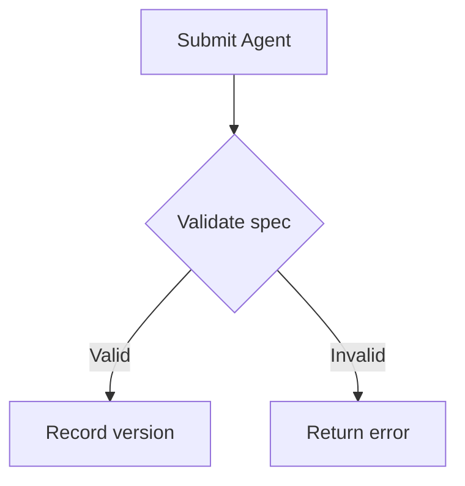

# Stigmer documentation style guide

This guide defines the writing conventions for all Stigmer documentation.
Automated enforcement is handled by Vale (`.vale.ini`) and Prettier
(`.prettierrc`). Pre-commit hooks run both tools on every commit.

## Audience

Stigmer documentation is written for **the developer adding agents to their
product**---an engineer who integrates Stigmer into what they ship. Every page
should answer: _"Does that developer need this to understand or integrate
Stigmer?"_ Who they are, and the words that describe Stigmer to them, are in
[`docs/vocabulary.md`](vocabulary.md), "What Stigmer is, and who it is for".

Do not write for casual end users. Assume readers are comfortable with APIs,
CLIs, and infrastructure concepts.

## Domain terminology

All Stigmer term definitions, capitalization rules, and context-specific usage
guidance live in [`docs/vocabulary.md`](vocabulary.md). That file is the single
source of truth.

**Short version**: capitalize Stigmer domain terms (Agent, Skill, Routine,
Session, etc.) when they refer to the platform concept. Lowercase when used
generically. Use the canonical forms (gRPC, ID, IDs). Vale enforces these
automatically via `vale/styles/Stigmer/terms.yml`.

See the vocabulary guide for the full term list, user-facing alternatives per
writing context, and good/bad examples.

## Headings

- Use **sentence casing**: capitalize only the first word and proper nouns.
  - _How to create an Agent_ (correct)
  - _How To Create An Agent_ (incorrect)
- Use **infinitive verb forms** for how-to titles.
  - _How to share an Agent_ (correct)
  - _Sharing an Agent_ (incorrect)
- Do not end headings with punctuation.

## Code blocks

- Always specify a language hint: ` ```go `, ` ```typescript `, ` ```yaml `,
  ` ```bash `, etc.
- Use `bash` (not `shell` or `sh`) for terminal commands.
- Prefix commands with `$` only when showing both the command and its output.
  Omit `$` for copy-pasteable command blocks.
- Keep blocks short. If a block exceeds 30 lines, break it into smaller pieces
  with explanatory prose between them.

### YAML blocks are contract-validated

Every ` ```yaml ` block in `docs/` is checked against the real proto contracts
by `make check-docs-yaml` (CI-enforced). A block must be one of:

1. **A resource manifest** — starts with `apiVersion:`/`kind:`. Validated
   automatically; no annotation needed.
2. **An anchored fragment** — a snippet of a larger resource. Tell the gate what
   it is a fragment of via the fence info string:
   - ` ```yaml validate-as="Agent" ` — body holds top-level resource fields
     (`spec:`, `status:`, ...)
   - ` ```yaml validate-as="Agent.spec" ` — body holds spec-level fields

   Absent fields are fine; unknown or misshapen fields fail the build.

3. **Explicitly skipped** — ` ```yaml no-validate="reason" `, only for blocks
   that are not resource YAML at all (e.g. frontmatter examples like the one
   below). The reason is mandatory.

Anything else fails the build. Consequences for authors: use full proto enum
names, never invent fields. Content that is markdown-with-frontmatter (like a
`SKILL.md` listing) belongs in a ` ```md ` fence, not ` ```yaml `.

Manifests are additionally held to **platform-parity protovalidate rules**
(stigmer/stigmer#305): the rules the platform itself evaluates when the resource
is applied — required fields, value lists, name patterns. Anchored fragments are
never rule-checked — partial-by-intent is their point. Run
`make report-docs-yaml-rules` for the rule findings as a report that never
fails.

### Code examples compile

Every ` ```typescript `, ` ```tsx `, ` ```go `, ` ```python ` and ` ```java `
block in `docs/` is compiled against the SDK it shows by
`make check-docs-snippets` (CI lane `ci.docs-snippets`). A block is one of:

1. **A whole file** — titled with its file name
   (` ```typescript title="client.ts" `, the title's extension its language's
   own), or a complete program (a Go `package` clause, a Java class). Compiled
   as it stands. A relative import (`./client.js`) reads the nearest titled
   block above it on the same page.
2. **A fragment** — a few statements, compiled with what every page may take as
   given and what the page shows:
   - the client, under the names every page uses: `stigmer` (or `client`) in
     TypeScript, `client` and `ctx` in Go, `client` in Python and Java. On the
     React, React-core, Ink and theme pages, a name the kit exports is in scope
     too. Nothing else is given: never an `id` or an `org`.
   - the page's **prelude**: a visible block marked ` ```go prelude ` (one per
     language) holding the imports the page's examples share, shown once where
     the reader looks for them, typically under an "imports" heading. It is
     never compiled alone, and a prelude with no fragment of its language on the
     page fails.
   - the block's own **hidden setup**: lines above a `// ---cut---` marker
     (`# ---cut---` in Python) that the site, the copy button and the markdown
     exports never show. Setup holds declarations only: a name the prose
     introduced (`declare const user: PlatformUser;`, `var user PlatformUser`,
     `user = PlatformUser()`, a Java field), with its real type (never `any` or
     `Any`, which hides what the compiler should check), and only the imports
     those declarations need. An import the visible code uses is shown, in the
     block or the page's prelude, never hidden. Never logic the reader needs to
     understand the example: if the hidden lines carry meaning, they belong in
     the body.
3. **Explicitly skipped** — ` ```go no-compile="reason" `, for pseudo-code, a
   sketch with elided arguments, or a wrong value shown beside a right one. The
   reason is mandatory and says why.

An example that returns a value is the function it belongs to: write the
`func provisionUser(...)` or the Java method, so the reader sees what it returns
to, never a bare `return "", err`.

The fences allowed to fail today are listed in
`test/docs-snippets-known-failing.json`, by page and by the digest of their
text. The list may only shrink: a changed block leaves it and must compile, and
a block fixed while listed fails the gate until `--prune` drops it. Never add to
it.

## Classify every page

Every hand-authored page has an entry in `docs/_inventory/classification.yaml`,
checked in CI by `make check-docs-inventory`. The entry records three decisions:
**fate** (does the page survive the docs revamp, and how), **diataxis**
(tutorial, how-to, explanation, reference, or landing — one type per page, never
mixed), and **medium**.

Prose and code are the substrate of every page, not a medium. `medium` names the
page's demonstration centerpiece, if it has one. Pick it with this rule, first
"yes" wins:

1. Is it structure rather than a screen? → `diagram`
2. Must the reader manipulate it to learn? → `interactive`
3. Does nothing change across frames? → `still`
4. Does the reader act in sequence at their own pace? → `screenshot-journey`
5. Is the timing or sequence itself the lesson? → `animated-tour`
6. Otherwise → `none`

Reserve `animated-tour` for genuine demonstrations — a capability that must be
seen working. Getting-started journeys and console procedures are
`screenshot-journey`: the reader compares their own screen against the depicted
one and sets the pace.

A page shows a screen only as a picture the visual suite draws. Put the values
the page prints and the picture shows in the page's example in
`test/visual/src/docs-examples.ts`, add an entry to the shown list in
`test/visual/src/shown.ts` (a gallery scene, cropped with `clip` to the part of
the screen the step acts on), mint it with `make test-visual UPDATE=1`, and
embed it with `<Screen>` right after the step it shows (see [Screen](#screen)).
When the product's look changes, the suite fails until the picture is drawn
again, and the redrawn picture reaches the site in the same pull request; when
the page's words change, the site's `docs-screens` test fails until the example
changes with them. Never add a screenshot captured by hand, not even as a
placeholder: it goes stale with no signal. Navigation and other sites' screens
stay prose.

`still` and `screenshot-journey` are held, not only planned:
`make check-docs-inventory` fails a page of either medium with no `<Screen>`,
and a page of any other medium with one. A page still waiting for its pictures
is listed with its reason in `OWED_PICTURES` (`site/src/lib/docs-inventory.ts`),
and leaves the list in the change that pictures it. For an `animated-tour` page
with no recording yet, as for `diagram`, `medium` remains the page's target.

An `interactive` page embeds the kit live with `<Live>` or `<ThemePlayground>`
(see [Live](#live)): a gallery scene the visual suite draws, framed in its docs
mode, where a scripted server answers a reader's send, approval and Stop. Never
build a demo of your own for a page: a demo kept beside the product goes stale
the way a captured screenshot does.

An `animated-tour` page about the terminal embeds `<TerminalRecording>` (see
[TerminalRecording](#terminalrecording)): the terminal kit's own frames, drawn
over a story of the scenario catalogue one event at a time and held by the kit's
tests. Never record a terminal by hand for a page. An `animated-tour` page with
no recording to play stays prose, code, and diagrams until it has one.

Generated pages (the `cli/commands/`, `sdk/react/`, `sdk/resources/`,
`sdk/ink/`, and `sdk/theme/` reference sets) are covered by cohort rules in the
same file and need no per-page entry.

When you add a page, add its entry. When you delete or move a page, update its
entry (remove it, or re-key it) in the same commit. CI fails on any mismatch and
names the page.

## MDX components

Custom components are available in all `.mdx` files without imports. Use them to
improve readability and structure.

### Callouts

Highlight important information with a colored sidebar and icon. Supported
types: `info`, `warn` (or `warning`), `error`, `success`.

```mdx
<Callout type="info">General information the reader should know.</Callout>
<Callout type="warn">Something the reader should be cautious about.</Callout>
<Callout type="error">A critical warning or breaking change.</Callout>
<Callout type="success">A positive outcome or confirmation.</Callout>
```

### Cards

Link card grids for navigation hubs and landing pages.

```mdx
<Cards>
  <Card href="/docs/concepts" title="Core Concepts">
    Understand Agents, Sessions, Skills, and how they fit together.
  </Card>
  <Card href="/docs/getting-started" title="Getting Started">
    Install Stigmer and run your first Agent in under five minutes.
  </Card>
</Cards>
```

### Tabs

Show alternative content (install methods, platform-specific instructions).

```mdx
<Tabs items={["npm", "yarn", "pnpm"]}>
  <Tab value="npm">npm install @stigmer/client</Tab>
  <Tab value="yarn">yarn add @stigmer/client</Tab>
  <Tab value="pnpm">pnpm add @stigmer/client</Tab>
</Tabs>
```

### SDK language tabs

Use `<SDKTabs>` for multi-language SDK code examples. The selected language
persists across pages.

```mdx
<SDKTabs>
  <Tab value="Go">Go code here</Tab>
  <Tab value="TypeScript">TypeScript code here</Tab>
  <Tab value="Python">Python code here</Tab>
  <Tab value="Java">Java code here</Tab>
</SDKTabs>
```

### Steps

Numbered step-by-step instructions for tutorials and how-to guides.

```mdx
<Steps>
  <Step>### Install the CLI Download and install the Stigmer CLI.</Step>
  <Step>### Create an Agent Define your first Agent.</Step>
</Steps>
```

### Term tooltips

Wrap a Stigmer domain term in `<Term>` to show its definition on hover.
Definitions come from the glossary at `site/src/components/docs/glossary.ts`.

```mdx
When you create a <Term>Skill</Term>, you write its instructions.
```

### File trees

Visualize directory structures with interactive expand/collapse.

```mdx
<Files>
  <Folder name="docs" defaultOpen>
    <File name="index.mdx" />
    <Folder name="concepts">
      <File name="agents.mdx" />
    </Folder>
  </Folder>
</Files>
```

### Accordions

Collapsible sections for FAQ-style content or optional detail.

```mdx
<Accordions>
  <Accordion title="What is an Agent?">
    A reusable definition of what an AI assistant knows and can do.
  </Accordion>
</Accordions>
```

### TypeTable

Structured property tables for API reference documentation.

```mdx
<TypeTable
  type={{
    name: { type: "string", description: "Agent name.", required: true },
    model: { type: "string", description: "LLM model.", default: "gpt-4o" },
  }}
/>
```

### Screen

A screen of the product, drawn by the visual suite. `name` is an entry in
`test/visual/src/shown.ts`; `alt` describes what the screen shows. The picture
is sized from the list, served sharp on a retina screen, and opens larger when
selected. In the markdown exports the tag becomes an image whose label is the
alt text. The build fails on a name the list does not hold or on blank alt text.

```mdx
<Screen
  name="approval"
  alt="A file edit waits for approval, with Approve and Deny"
/>
```

### Live

A part of the React kit, live: a gallery scene the visual suite draws, framed in
its docs mode. `name` is an entry in `test/visual/src/live.ts`; `alt` describes
what the demo shows. A reader can send a message, approve the command the agent
asks to run, and stop a turn; a scripted server answers, and the caption under
the frame says so. In the markdown exports the tag becomes the alt text, linked
to the demo. The build fails on a name the list does not hold or on blank alt
text. To embed a scene the list lacks, add its entry (`test/visual/README.md`,
"Live demos").

```mdx
<Live
  name="chat-popup"
  alt="AgentChat as a corner popup, open on a finished turn"
/>
```

`<ThemePlayground />` is the theming page's: the six presets, light or dark and
the corner radius on a live chat panel, with the code that gives a product that
look.

### TerminalRecording

A terminal session, played: the frames the terminal kit's `SessionView` draws
over a story, event by event. `name` is an entry in `sdk/ink/src/recordings.ts`,
whose frames the kit's test holds in `sdk/ink/src/__tests__/__recordings__/`;
`alt` describes what the session shows. It plays when scrolled into view, pauses
and replays, and shows the last frame to a reader who asked for less motion. In
the markdown exports the tag becomes the alt text and the last frame as a text
block. The build fails on a name the list does not hold or on blank alt text.

```mdx
<TerminalRecording
  name="run-approval"
  alt="The agent reads two files, asks before it runs git log, and answers"
/>
```

### Diagram

A drawing in the site's own language: the homepage's boxes, frames and lines, or
a list styled as a picture. `name` is an entry in
`site/src/components/visuals/diagrams.ts`, which holds each drawing and the text
it stands for. The drawing lays out by its own width, from a wide layout down to
the phone's, and its words are page text. In the markdown exports the tag
becomes that text, as its own paragraph. The build fails on a name the list does
not hold.

```mdx
<Diagram name="runner-queue" />
```

### ImageZoom

Click-to-zoom for an image that is not a screen of the product, such as an
exported diagram. A screen of the product is a `Screen`, never an image file.

```mdx
<ImageZoom src="/docs/<file>.png" alt="What the image shows" />
```

## Prose

- Write in **second person** ("you") when addressing the reader.
- Use **active voice**. Vale enforces this via the Google style.
- Use **contractions** (you'll, it's, don't). They make prose more approachable.
- Keep sentences short. If a sentence spans more than two lines in an
  80-character-wide editor, split it.
- Use inclusive language. Vale enforces this via the `alex` package.
- Use em dashes without surrounding spaces---like this.

## File conventions

- **Extension**: `.mdx` for all rendered documentation files.
- **Naming**: lowercase with hyphens (`agent-lifecycle.mdx`, not
  `AgentLifecycle.mdx`).
- **Front matter**: every file must have `title` and `description`.

```yaml no-validate="docs-page frontmatter example, not resource YAML"
---
title: How to create an Agent
description: Step-by-step guide to defining and running your first Agent.
---
```

## Formatting

- Prettier autoformats on commit. Configuration is in `.prettierrc`:
  - 80-character line width
  - 2-space indentation
  - Prose wrapping at word boundaries (`proseWrap: always`)
- Use **bold** for UI elements and key concepts on first mention.
- Use `code` formatting for CLI commands, file paths, config keys, and API
  fields.
- Use tables to compare options or list parameters.
- Use Mermaid diagrams for architecture, data flows, and state machines; a
  concept page's own system picture is a `Diagram` (see "Diagrams").

## Diagrams

Fenced ` ```mermaid ` code blocks render as interactive diagrams (client-side
via Mermaid.js) in the site's dark theme. Prefer diagrams over lengthy textual
descriptions of architecture or data flow.

A concept page's picture of its own system, the one a reader returns to, is a
`Diagram`: drawn in the site's language, readable at phone width, and carried
into the markdown exports as text (the Runners page's queue, the Sessions page's
log). Every other diagram is Mermaid. A new `Diagram` is code: its drawing, its
text and its test live in `site/src/components/visuals/`.

````mdx

````

Supported diagram types include `flowchart`, `sequenceDiagram`,
`stateDiagram-v2`, `classDiagram`, `erDiagram`, and `gantt`. See the
[Mermaid documentation](https://mermaid.js.org/) for full syntax.

## Links

- Use relative paths for internal links: `[Agents](../concepts/agents.mdx)`.
- Use descriptive link text. Avoid "click here" or bare URLs.
- The `check-links` Make target validates all links before CI.

## LLM-friendly output

The build pipeline generates files that let LLM agents and AI tools consume
Stigmer documentation as plain text, following the
[llms.txt standard](https://llmstxt.org).

### Generated files

| File                | Address                     | Purpose                                           |
| ------------------- | --------------------------- | ------------------------------------------------- |
| `out/llms.txt`      | `stigmer.ai/llms.txt`       | Curated index with section links and descriptions |
| `out/llms-full.txt` | `stigmer.ai/llms-full.txt`  | All documentation concatenated into one file      |
| `out/docs/**/*.md`  | `stigmer.ai/docs/{path}.md` | Per-page markdown variant of each doc page        |

### How it works

The script `site/scripts/generate-llms-txt.ts` runs automatically after
`next build`. It reads all `.mdx` files from `docs/`, strips frontmatter and
import statements, and writes cleaned markdown to `out/`. A `Screen` becomes a
markdown image of its alt text, and a `Diagram` becomes the text it stands for,
so no picture leaves a bare tag behind. Page ordering follows the `meta.json`
files. Individual CLI command pages and the contributing section are placed in
an "Optional" section in `llms.txt`.

### Commands

- `make docs-build` --- runs the full build including LLM output
- `make gen-llms` --- regenerates LLM output from an existing `out/` directory
- `cd site && yarn generate-llms` --- same as above from the site directory

### Copy as Markdown button

Every docs page includes a "Copy as Markdown" button next to the title. It
fetches the `.md` variant of the current page and copies the content to the
clipboard so users can share documentation context with AI tools.

## What not to do

- Do not add comments that narrate what the code does ("Import the module").
- Do not duplicate content. Link to the authoritative page instead.
- Do not write speculative documentation. Every statement must be grounded in
  the current implementation.
- Do not use emoji in headings or as bullet markers.
