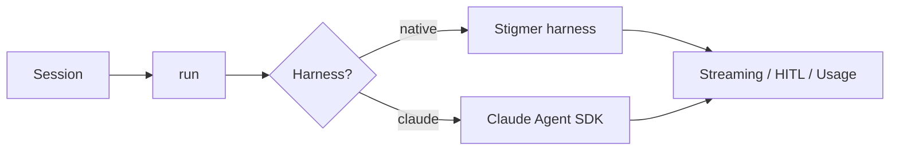

Every [Session](/docs/concepts/sessions) needs a runtime that processes the
Agent's turns, calls models, runs tools, and streams results. In Stigmer, that
runtime is called a **Harness**.

Stigmer supports two harnesses:

- **Stigmer** (`native`) — Stigmer's own harness: runs any catalog model, open
  source end to end, in TypeScript inside the Stigmer runner.
- **Claude Agent** (`claude`) — Anthropic's Claude Agent SDK, Powered by Claude,
  running Claude models on your Organization's own Anthropic key.

The Harness is a Session-level choice. You pick it when you create a Session,
and it stays fixed for the life of that conversation.

## Stigmer harness

Stigmer's own Harness is the default. When you create a Session without
specifying a Harness, it uses the Agent's own `harness` (part of its
[run settings](/docs/concepts/agents#run-settings)), and Stigmer's when the
Agent names none. It is built on LangChain's open source
[deepagents](https://github.com/langchain-ai/deepagentsjs), on LangGraph.js.

**What you get:**

- Full control over model selection: every model the catalog lists for the
  Stigmer harness, and any model your own OpenAI- or Anthropic-compatible
  endpoint serves, named `openai:<name>` or `anthropic:<name>`
  ([Model Provider Keys](/docs/guides/integrations/model-provider-keys#run-a-model-your-endpoint-serves)).
- Deep integration with Stigmer's checkpoint, pause/resume, and sandbox
  features.
- The same execution model documented throughout the rest of these docs —
  [Runners](/docs/concepts/runners) pick up work,
  [approval flows](/docs/concepts/approval-flows) gate tool calls, and
  [Skills](/docs/concepts/skills) inject domain knowledge.
- Shell command execution on local Workspaces through the `execute` tool.
  Commands run on the host machine attached to the runner, and every command
  goes through the same approval gate as other mutating tools. Plan mode
  (read-only Sessions) does not expose shell execution, and its file reads are
  scoped to the Session's Workspace — the Agent cannot read paths outside it.
  The Agent can run a command in the background, such as a test suite or a dev
  server, keep working while it runs, and is told when it ends. The console
  shows the command's output as it arrives and how it ended, and offers Stop,
  which ends that command alone. A background command stops when its turn ends
  or pauses for approval.
- Built-in web retrieval through the `web_fetch` tool — every Session on the
  Stigmer harness can fetch a public URL and read it as Markdown, with no MCP
  server to configure. The tool is read-only and asks for no approval unless an
  Agent's hooks ask about it; on managed cloud runners it refuses private and
  internal addresses.

The Stigmer harness is the right choice for most workloads. It gives you the
widest model catalog and the deepest platform integration.

## Claude harness

The Claude harness runs the Agent's turns on Anthropic's Claude Agent SDK. The
console and the CLI name it **Claude Agent**, Powered by Claude; its CLI and API
word is `claude`.

**What you get:**

- Claude models from the model catalog: the same models, ids and prices as the
  Stigmer harness's Anthropic models, with thinking in the form each model
  supports and its reasoning readable.
- Model calls on your Organization's own Anthropic key. In the hosted cloud, a
  Claude run with no Anthropic key is refused when it is created, naming
  Anthropic, so you add the key rather than watch a run fail.
- [Approval flows](/docs/concepts/approval-flows) that stop at the exact call:
  the run waits for a person, and the call that runs is exactly the one that was
  approved.
- The Agent's tool lists, Skills, sub-agents, MCP servers and hooks in either
  format, file review, the cost cap, stop, and the Session's event log, as on
  the Stigmer harness.
- Nothing to install: the runner images carry the Claude Agent SDK, and the
  desktop app and `stigmer up` download it on the first Claude turn.
  [Set up the Claude harness](/docs/guides/runners/claude-harness) says where it
  comes from in each edition.

**What it does not offer yet:**

- Background commands: a long command runs in the foreground, and the turn waits
  for it to end.
- Web fetch and web search: give the Agent an MCP server for the web.
- The Stigmer harness's built-in helpers: a Claude turn delegates only to the
  Agent's own sub-agents and its plugins' agents.
- The fast tier: a Claude run takes the standard tier.
- Resuming a recorded conversation in an eval case: such a case is listed as
  `not run on Claude Agent: resumed conversations` and runs on the Stigmer
  harness.

## Choosing a Harness

The Harness you choose depends on what your Agent needs to do.

|                              | Stigmer (`native`)                                                                          | Claude Agent (`claude`)                                              |
| ---------------------------- | ------------------------------------------------------------------------------------------- | -------------------------------------------------------------------- |
| **Default**                  | Yes                                                                                         | No — must be explicitly selected                                     |
| **Model availability**       | The catalog's Stigmer models, and your own endpoint's (`openai:<name>`, `anthropic:<name>`) | Claude models only                                                   |
| **Tool capabilities**        | MCP servers from your plugins and your Agent + built-in web fetch                           | MCP servers + the SDK's file tools, with the shell run by the runner |
| **Checkpoints**              | Full Stigmer pause/resume                                                                   | The SDK's conversation, kept by Stigmer                              |
| **Repository instructions**  | `AGENTS.md`, else `CLAUDE.md`: the root's and each folder's                                 | `AGENTS.md`, else `CLAUDE.md`: the root's and each folder's          |
| **Who bills model calls**    | Your provider, on your Organization's key                                                   | Anthropic, on your Organization's Anthropic key                      |
| **Harness context per call** | Stigmer's system prompt and tool schemas, cached after the first call                       | The Claude Agent SDK's own system prompt, with Stigmer's additions   |
| **Prompt caching**           | Full control (explicit breakpoints)                                                         | Managed by the Claude Agent SDK                                      |
| **Latency**                  | No process start-up per turn                                                                | The Claude Agent SDK starts its own process for each turn            |
| **Best for**                 | General-purpose agents, custom model selection, production workloads                        | Agents that want Anthropic's own loop on Claude models               |

Stigmer also ran a Cursor harness, which was retired; the models only it served
(Gemini, Kimi, GLM, Grok, Composer, Auto, and GPT in the open-source catalog)
are reached on the Stigmer harness through your Organization's own
OpenAI-compatible endpoint, named `openai:<name>`.

<Callout type="info">
  A Session's Harness is immutable after the first run starts. Choose the right
  Harness when you create the Session — you cannot switch later.
</Callout>

## How it works

Every harness feeds into the same Stigmer pipeline. The difference is which
runtime processes the Agent's turns — the rest of the system (streaming,
approval flows, usage tracking, cost caps) works the same regardless of Harness.



One [Runner](/docs/concepts/runners) serves every harness it carries. The
Harness is a property of the Session and travels with each run on the same task
queue; the runner reads it and hands the work to the matching runtime. You don't
need separate runner processes, or separate queues, for each Harness.

## Creating a Session with a Harness

You set the Harness when creating a Session. If you omit it, the Session starts
on the Agent's `harness`, and on the Stigmer harness when the Agent names none.

<Tabs items={["TypeScript", "Go"]}>
  <Tab value="TypeScript">

```typescript
import { Harness } from "@stigmer/apis/ai/stigmer/agentic/session/v1/enum_pb";

const session = await client.session.create({
  name: "q3-variance-review",
  org: "acme",
  subject: "Q3 variance review",
  agentRef: { org: "acme", slug: "variance-reporter" },
  harness: Harness.CLAUDE, // or Harness.NATIVE
});
```

  </Tab>
  <Tab value="Go">

```go
session, err := client.Session.Create(ctx, &stigmer.SessionInput{
    Name:     "q3-variance-review",
    Org:      "acme",
    Subject:  "Q3 variance review",
    AgentRef: stigmer.ResourceRef{Org: "acme", Slug: "variance-reporter"},
    Harness:  sessionv1.Harness_HARNESS_CLAUDE, // or Harness_HARNESS_NATIVE
})
```

  </Tab>
</Tabs>

In the web console, the model picker names the Harness beside the model: choose
Claude Agent there and the picker lists its Claude models. On the CLI,
`--harness claude` starts a Session on Claude Agent, and `--harness native` on
Stigmer's own harness.

## Cost considerations

Stigmer charges nothing per call on any harness: each runs on your own keys.
Cost differences come from two places: harness context per call, and prompt
caching.

- **Harness context per call** — every harness sends a preamble of its own with
  every call, and none is your prompt alone. The Stigmer harness sends Stigmer's
  system prompt and tool schemas; Claude Agent sends the Claude Agent SDK's own
  system prompt, with Stigmer's additions.
- **Prompt caching** — the Stigmer harness exposes explicit cache breakpoints,
  so a Session's stable prefix is re-read at about one-tenth the input rate
  (about 90% off those tokens) and the advantage compounds across turns. On
  Claude Agent the Claude Agent SDK manages caching itself.

For a full rundown of cost levers, see
[Optimizing your costs](/docs/concepts/billing#optimizing-your-costs).

## What's next

Ready to run the Claude harness?
[Set up the Claude harness](/docs/guides/runners/claude-harness) says where each
edition gets the Claude Agent SDK and how a local runner installs it.

To understand how Sessions work in more detail — including session-level Skills
and plugins — see [Sessions](/docs/concepts/sessions).
