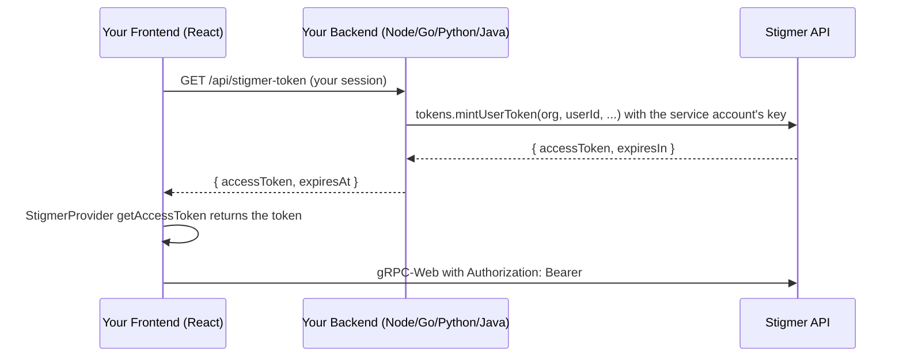

Your product already knows who its users are. To give them Stigmer components
(sessions, agents, conversations) in their browser, your backend asks Stigmer
for a short-lived token for each of them, the way it would ask a payments or
messaging platform with its server key, and your frontend hands that token to
the React SDK. It works the same on Stigmer Cloud and on a self-hosted server
with sign-in configured.

## When to use this

Use this when your product has its own sign-in (sessions, cookies, your own user
table) and your users need to reach Stigmer from the browser.

<Callout type="info">
  **Looking for a different auth method?** If your users already sign in through
  an OIDC provider (Auth0, Okta, Entra ID), let Stigmer trust it directly with
  [identity federation](/docs/guides/authentication/federation/overview). If
  your backend calls the Stigmer API itself, with no browser and no end users,
  use a [service account's API
  key](/docs/guides/authentication/service-accounts) on its own. The
  [authentication overview](/docs/guides/authentication/overview) compares them.
</Callout>

## How it works



1. Your backend authenticates the user (your auth, your session).
2. Your backend calls `mintUserToken` with the API key of a service account that
   is an admin of your Organization, naming the Organization and the user.
3. Stigmer returns a signed token for that user, bound to the Organization the
   call names: your own, or one of its
   [child organizations](/docs/guides/authentication/federation/child-organizations).
   The token works in that Organization only.
4. Your frontend passes the token to `StigmerProvider` through `getAccessToken`.

## Prerequisites

- A Stigmer server that authenticates its callers: Stigmer Cloud, or a
  self-hosted server with sign-in configured (`STIGMER_OIDC_ISSUER`, see
  [authentication](/docs/guides/self-hosting/authentication)). A server that
  trusts every request refuses to mint tokens, because nothing there would
  verify them.
- A [service account](/docs/guides/authentication/service-accounts) with the
  **admin** role in your Organization, and an API key for it. An admin creates
  both under Settings > Service accounts. Minting creates accounts and grants
  them a role, an administrator's act, so a key whose account is not an admin is
  refused.
- The key stored on your backend, for example as `STIGMER_API_KEY`. Never put it
  in browser code.

## Set how people sign in

Your Organization's **embedding settings** decide what happens when your backend
mints a token. An admin sets them under Settings > Embedding, or with
`organization.updateEmbedding`:

- **Create accounts on sign-in**: create a Stigmer account the first time a
  token is minted for a user who has none. When off, minting for an unknown user
  fails with `FAILED_PRECONDITION`.
- **Sign-in role**: the role that new account receives on your Organization.
  Unset grants nothing, so your backend can grant roles itself. A sign-in role
  requires account creation, and `owner` is refused: Organization ownership is
  always assigned explicitly.
- **Allowed origins**: the web origins whose pages may use the tokens (see
  [Security notes](#security-notes)). Empty allows every origin.
- **Vaults**: shared vaults whose keys your users' conversations use (see
  [below](#give-embedded-assistants-their-credentials)).

For example, with account creation on and the sign-in role `viewer`, the first
token you mint for `user_123` creates their account and makes them a viewer of
your Organization: they see what is shared with it and cannot start
conversations. Set `member` for users who chat with your Agents.

The settings apply when an account is first created. An account that already
exists keeps the roles and profile it has: changing the settings later, or
passing a different email or name in a later mint, does not update it.

Every mint for one Organization resolves the same `user_id` to the same Stigmer
account, so use a stable identifier (your Auth0 `sub`, Clerk user ID, or
database primary key). A token minted into one of your child organizations
resolves in that child, where the same `user_id` is a separate account.

## Backend: Mint user tokens

Minting is one call on the ordinary Stigmer client, built with the service
account's API key.

### TypeScript (Node.js)

```typescript
import { createNodeClient } from "@stigmer/sdk/node";

const stigmer = createNodeClient({
  baseUrl: "https://api.stigmer.ai",
  apiKey: process.env.STIGMER_API_KEY!,
});

// In your /api/stigmer-token endpoint:
app.get("/api/stigmer-token", async (req, res) => {
  const { accessToken, expiresAt } = await stigmer.tokens.mintUserToken({
    org: "acme",
    userId: req.user.id,
    userEmail: req.user.email,
    userName: req.user.name,
  });
  res.json({ accessToken, expiresAt: expiresAt.toISOString() });
});
```

### Go

```go
import stigmer "github.com/stigmer/stigmer/sdk/go/v3"

client, err := stigmer.NewClient(stigmer.WithAPIKey(os.Getenv("STIGMER_API_KEY")))
if err != nil {
    log.Fatal(err)
}
defer client.Close()

result, err := client.Tokens.MintUserToken(ctx, &stigmer.MintUserTokenInput{
    Org:       "acme",
    UserID:    user.ID,
    UserEmail: user.Email,
    UserName:  user.Name,
})
```

### Python

```python
from stigmer import StigmerClient

with StigmerClient(os.environ["STIGMER_API_KEY"]) as client:
    result = client.tokens.mint_user_token(
        org="acme",
        user_id=current_user.id,
        user_email=current_user.email,
        user_name=current_user.name,
    )
```

### Java

```java
import ai.stigmer.sdk.MintUserTokenInput;
import ai.stigmer.sdk.MintUserTokenResult;
import ai.stigmer.sdk.StigmerClient;

try (StigmerClient client = StigmerClient.builder(System.getenv("STIGMER_API_KEY")).build()) {
    MintUserTokenResult result = client.tokens().mintUserToken(MintUserTokenInput.builder()
        .org("acme")
        .userId(currentUser.getId())
        .userEmail(currentUser.getEmail())
        .userName(currentUser.getName())
        .build());
}
```

## Frontend: Wire up StigmerProvider

Your frontend fetches the token from your backend and passes it to
`StigmerProvider`. No key is needed in the browser.

```tsx
import { StigmerProvider } from "@stigmer/react";
import { Stigmer } from "@stigmer/sdk";

let cachedToken: { accessToken: string; expiresAt: Date } | null = null;

async function getAccessToken(): Promise<string | null> {
  if (cachedToken && cachedToken.expiresAt > new Date()) {
    return cachedToken.accessToken;
  }
  const res = await fetch("/api/stigmer-token");
  const data = await res.json();
  cachedToken = {
    accessToken: data.accessToken,
    expiresAt: new Date(data.expiresAt),
  };
  return cachedToken.accessToken;
}

const stigmer = new Stigmer({
  baseUrl: "https://api.stigmer.ai",
  getAccessToken,
});

function App() {
  return (
    <StigmerProvider client={stigmer}>
      {/* Your app with Stigmer components */}
    </StigmerProvider>
  );
}
```

## Give embedded assistants their credentials

An embedded assistant often calls MCP servers that need a credential of your
own, such as a shared API secret. Put that credential in a shared
[vault](/docs/concepts/vaults) and list the vault in your Organization's
embedding settings. Every run a user signed in this way starts then uses the
vault, and so does a recovery of that run. The Agent stays as it is.

- **No vault of their own.** The runs of a user signed in from your product read
  no vault of that user's own: they use the vaults their Session names and the
  embedding settings' vaults.
- **Same Organization.** The vaults must belong to the Organization, and they
  are used only by its runs.
- **Kept up to date.** Stigmer reads the settings when each run starts, so an
  edit applies to the next run, and it checks that whoever attached each vault
  may still use it.
- **Kept valid.** If a listed vault is deleted, runs fail to start, naming it,
  until you remove it from the settings.

Runs started by a Schedule use the schedule's vaults, not the embedding
settings'. A key that belongs to one of your customers goes in that customer's
own vault instead: see
[Keep your customers' keys](/docs/guides/authentication/customer-keys).

## Error handling

All SDKs return structured errors with actionable messages:

| Error code            | When                                                                                             | What to do                                                                                   |
| --------------------- | ------------------------------------------------------------------------------------------------ | -------------------------------------------------------------------------------------------- |
| `PERMISSION_DENIED`   | The key is not a service account's (a person's key or token)                                     | Mint with a service account's API key.                                                       |
| `PERMISSION_DENIED`   | The service account is not an admin of the Organization the call names, or of its parent         | Give the service account the admin role, or mint into its own Organization or a child of it. |
| `FAILED_PRECONDITION` | The user has no account and the embedding settings do not create one                             | Turn on account creation in the embedding settings, or create the account first.             |
| `FAILED_PRECONDITION` | The server trusts every request                                                                  | Configure sign-in on the server (`STIGMER_OIDC_ISSUER`).                                     |
| `INVALID_ARGUMENT`    | `user_id` is blank or contains `\|`                                                              | Pass your stable user identifier.                                                            |
| `UNAUTHENTICATED`     | An API call bearing a token whose service account was deleted                                    | Mint a new token with an active service account's key.                                       |
| `UNAUTHENTICATED`     | An API call bearing a token that names no service account, or another Organization than its own  | Use a token `mintUserToken` returned, unchanged.                                             |
| `PERMISSION_DENIED`   | An API call bearing the minted token targets another Organization than the one it was minted for | Minted tokens work in one Organization only. Mint a token for the target Organization.       |
| `PERMISSION_DENIED`   | A browser API call bearing the minted token came from an origin not in the allowed origins       | Add the requesting origin to the allowed origins in the Organization's embedding settings.   |

## Security notes

- The service account's API key is a backend-only credential. Never include it
  in browser bundles, mobile apps, or client-side code.
- Anyone holding the key can mint a token for any `user_id` in the Organization,
  including a user an admin has since promoted: an existing account signs in
  with the roles it holds now, as it would through federation. Guard the key as
  you guard an admin's credentials.
- Tokens live 15 minutes. Deleting the service account ends every token it
  minted on its next request; rotating its key does not, so a rotation never
  signs your users out.
- The email and name you pass to `mintUserToken` are your assertion. Stigmer
  shows them and grants nothing because of them.
- Tokens are signed by the server's own platform-token key and verified
  in-process: Stigmer's key on Stigmer Cloud, and on a self-hosted server
  `STIGMER_PLATFORM_TOKEN_KEY` or a key the server generates. There is no JWKS
  endpoint (yet).
- Use the allowed origins to restrict which browser origins can use the tokens.
  Enforcement happens on the browser's API calls, not on `mintUserToken`
  (minting is server-to-server and carries no browser Origin): with a non-empty
  list, requests whose `Origin` header is unlisted are refused
  `PERMISSION_DENIED`; an empty list disables the check. Requests without an
  `Origin` header always pass: this is a browser-context defense against a
  leaked token being replayed from another site, and the key remains the primary
  control.
- The embedding settings are readable by everyone who reads the Organization,
  its app users included. They hold no secret: origins are what browsers send,
  and vaults are named, never opened.

## Troubleshooting

<Steps>
<Step>

### Check the key's account

`PERMISSION_DENIED` on `mintUserToken` means the key is not a service account's,
or its account is not an admin of the Organization the call names. Check under
Settings > Service accounts that the account has the admin role.

</Step>
<Step>

### Check if the user exists

`FAILED_PRECONDITION` naming the user means the user has no Stigmer account and
the Organization's embedding settings do not create one. Turn on account
creation under Settings > Embedding, or create the account before calling
`mintUserToken`.

</Step>
<Step>

### Check the browser's origin

`PERMISSION_DENIED` naming an origin on a browser request means the page's
origin is not in the allowed origins. Add it under Settings > Embedding.

</Step>
<Step>

### Check the target Organization

A minted token works only in the Organization it was minted for, whatever roles
the user holds elsewhere. `PERMISSION_DENIED` on a call that names another
Organization's resource means the token is bound elsewhere. The token can still
reach the user's own account and API keys, and, in a child organization, read
and run the Agents, Skills and Plugins its parent shares with its children.

</Step>
</Steps>

## What's next

- [Service accounts](/docs/guides/authentication/service-accounts): create the
  account and its key.
- [Identity federation](/docs/guides/authentication/federation/overview): trust
  your OIDC provider instead.
- [Embed an agent](/docs/guides/sharing/embed-an-agent): put an agent in your
  product.
