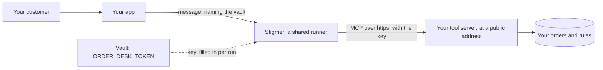

When everything an Agent does is a call to your own service, such as looking up
an order or reading your refund rules, it needs no computer. An Agent without
one needs no sandbox: on Stigmer Cloud each turn runs on a runner shared by
every such conversation, with nothing to start or wake, so it answers sooner
([how much sooner](/docs/concepts/agents#how-much-sooner-it-answers)). This
guide builds one: a shop's order desk whose tools live on the shop's own server.

The finished app is
[`examples/apps/order-desk`](https://github.com/stigmer/stigmer/tree/main/examples/apps/order-desk)
in the Stigmer repository. Copy the folder, and its README runs it on your
machine in four commands.



Your app sends the message and names a vault. A shared runner runs the turn,
reads the key from that vault, and calls your tool server at its public address
with the key in a header. Your server answers from your own data. The key never
appears in the Agent, and no part of the turn runs on a computer.

## Serve your tools over MCP

Your tools are an MCP server reached over HTTP. The order desk's
[`server.ts`](https://github.com/stigmer/stigmer/blob/main/examples/apps/order-desk/server.ts)
serves two read-only tools with the MCP TypeScript SDK (`McpServer` over
Streamable HTTP, stateless):

- `look_up_order` takes an order number and returns its status, items, carrier,
  tracking number, delivery date and the last day it can be returned.
- `refund_policy` returns the shop's return rules.

The server refuses every request whose `Authorization` header isn't
`Bearer <ORDER_DESK_TOKEN>`. That matters: the next step puts it on the
internet, where anyone who finds its address can call it.

Mark a tool that only reads with the `readOnlyHint` annotation. A tool marked
`destructiveHint` asks the person before it runs
([Connect an MCP server](/docs/guides/integrations/connect-an-mcp-server)).

## Give it a public address

An Agent without a computer reaches only the internet: not your machine and not
a private network, wherever Stigmer runs, `stigmer up` on your own laptop
included. Stigmer refuses to save such an Agent with a server at
`http://localhost:8787/mcp` or `https://10.0.0.5/mcp`, and the refusal names the
server.

In production your tool server already has a public `https` address. On your
laptop, a tunnel gives it one. Cloudflare's quick tunnel needs no account:

```bash
cloudflared tunnel --url http://localhost:8787
```

It prints an address like `https://<words>.trycloudflare.com`. The address
changes each time the tunnel starts, and a new one can take a minute to resolve:
until it does, a turn fails saying the address "does not resolve to a public
address".

## Keep the key in a vault

The Agent's header names the key as `${ORDER_DESK_TOKEN}`, never its text: an
Agent's headers are returned to anyone who can read the Agent. The value goes in
a [Vault](/docs/concepts/vaults) your app owns:

```typescript
declare const vaultId: string;
declare const orderDeskToken: string;
// ---cut---
await stigmer.vault.setSecrets({
  vault: { org: "acme-shop", vault: { case: "id", value: vaultId } },
  secrets: { ORDER_DESK_TOKEN: { value: orderDeskToken } },
});
```

The example creates the vault, `order-desk`, the first time it runs
([`agent.ts`](https://github.com/stigmer/stigmer/blob/main/examples/apps/order-desk/agent.ts)).

## Make the Agent

The Agent has no computer, one MCP server of its own at the public address, and
that server's tools as its only tools:

```yaml validate-as="Agent"
spec:
  instructions: |
    You answer a shop's customers about their orders.
    Look the order up with look_up_order before you say anything about it,
    and read refund_policy before you say whether something can be returned.
  computer: COMPUTER_NONE
  mcp_servers:
    - name: orders
      url: https://orders.acme-shop.example/mcp
      headers:
        Authorization: Bearer ${ORDER_DESK_TOKEN}
  tools: [mcp__orders]
```

From your code, `apply` creates the Agent or updates it, found by its slug, so
your app can run the same call every time it starts, or whenever the address
changes:

```typescript
import { Computer } from "@stigmer/apis/ai/stigmer/agentic/session/v1/enum_pb";

const agent = await stigmer.agent.apply({
  org: "acme-shop",
  name: "Order desk",
  slug: "order-desk",
  instructions: "You answer a shop's customers about their orders.",
  computer: Computer.NONE,
  mcpServers: [
    {
      name: "orders",
      url: "https://orders.acme-shop.example/mcp",
      headers: { Authorization: "Bearer ${ORDER_DESK_TOKEN}" },
    },
  ],
  tools: ["mcp__orders"],
});
```

Only your Organization's administrators may add a server to an Agent, so the
account behind your app's key is an administrator, or an administrator saves the
Agent once.

## Ask it

Start a conversation that names the vault. A conversation your app starts uses
the vaults it names and no others, so this is how the Agent's
`${ORDER_DESK_TOKEN}` gets its value:

```typescript
import { sendAndWait } from "@stigmer/client";

const turn = await sendAndWait(stigmer, {
  org: "acme-shop",
  sessionSpec: {
    agentRef: { org: "acme-shop", slug: "order-desk" },
    vaults: [{ org: "acme-shop", slug: "order-desk" }],
  },
  message: "Where is order 1042, and can I still return it?",
});
console.log(turn.answer);
```

The Agent calls `look_up_order` and `refund_policy` on your server, and answers
from what they return. For a product whose customers each have their own key,
keep each customer's key in their own vault and name that vault instead
([Keep your customers' keys](/docs/guides/authentication/customer-keys)).

## What it can't do

An Agent without a computer runs no commands and has no disk. Its files are its
notes, the conversation's uploads and the files it hands back, kept by Stigmer.
Stigmer refuses anything that needs a computer when the Agent is saved or a
conversation starts, naming what to remove:
[A computer, or none](/docs/concepts/agents#a-computer-or-none) lists each rule.
[Give an Agent its own MCP server](/docs/guides/integrations/connect-an-mcp-server#give-an-agent-its-own-mcp-server)
covers how its server logs in, and what changes reach which conversations.
