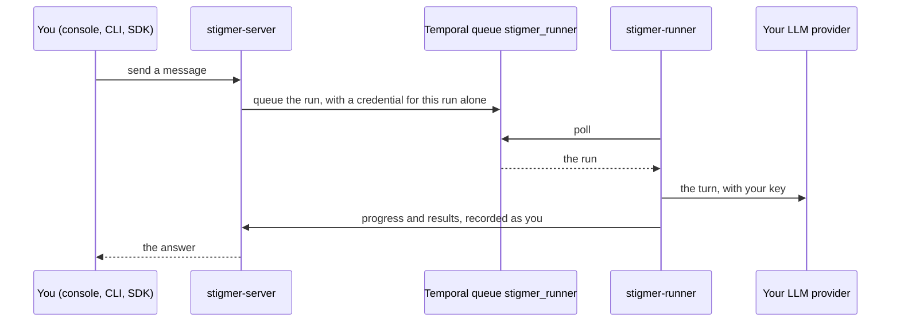

Every self-hosting guide ends the same way: a run "traveled from the CLI to the
server, through Temporal, and executed inside the runner". This page says what
that sentence means. The server stores your resources and serves the console and
the API. It never calls your LLM provider and never runs a tool. The runner does
both, on behalf of whoever started the run.

A runner isn't a resource. There's nothing to apply, nothing listed in the
console, and the server keeps no record of which runners exist. It's a process
your shape starts beside the server, and every shape starts exactly one:

- On your laptop, `stigmer up` starts a runner as its own process next to the
  server; `stigmer up server` starts the server alone, without one. The
  [all-in-one container](./all-in-one) runs the same composition inside one
  container.
- On the [Docker Compose stack](./docker-compose), the runner is the
  `stigmer-runner` service.
- On [Kubernetes](./kubernetes), the runner is the second container of the
  server's pod, which the Stigmer operator runs. With a sandbox driver, each
  Session whose Agent has a computer gets a runner of its own instead, and the
  operator runs one shared runner beside the sandboxes for Agents without a
  computer ([Agents without a computer](#agents-without-a-computer)).

## How a run reaches the runner

The server and the runner never talk about who does what. Between them sits a
Temporal task queue named `stigmer_runner`. The server puts each run on it; the
runner polls it and takes what's there. The name is written once for both sides,
in the compose file's one anchor and the operator's one constant, and a test
holds the two equal, so they can't drift apart.



Two things ride along with the run. The first is the Session's Harness (Stigmer
or Claude Agent); one runner serves both from the same queue. The second is a
credential the server mints for that run alone. Everything the runner does for
the run, including the status it reports and the resources it creates, is
recorded as the person who started it, whoever's key the runner process holds.
The [authentication guide](./authentication#what-changes) has the rules.

## When the runner is gone

Nothing on the server notices a runner leaving; it finds out when a run has
nobody to take it. **A run waits five minutes, then fails.** Its status carries
the reason: `No worker available to execute activity`, followed by the three
usual causes, starting with "the Stigmer runner is not running". The console and
the CLI both show it. Start the run again once the runner is back.

That is the external runner's case. With the `substrate` driver, a full sandbox
fleet doesn't end a run this way: the run waits for room, as
[When every sandbox is busy](#when-every-sandbox-is-busy) describes.

A runner that dies in the middle of an Agent turn is a different case. The
runner reports to Temporal every 30 seconds while it works; when two minutes
pass without a report, the server resumes the turn from the runner's last
checkpoint, as long as it has resumed it fewer than ten times within the hour
and a runner is back within five minutes. The checkpoint lives under the
runner's own `/data`, which is why the `runner-data` volume and the
`stigmer-runner-data` claim exist: lose them and runs in flight lose their
place, but nothing durable is lost.

How you know the runner is alive today: its log.
`Worker ready, polling for tasks...` is the line to look for, in
`docker compose logs stigmer-runner` or
`kubectl logs deployment/stigmer -c runner` (`deployment/stigmer-runner` with a
sandbox driver). The runner has no health endpoint yet, so the operator gives
its container no probe on purpose
([stigmer#1101](https://github.com/stigmer/stigmer/issues/1101)), and the
console has no runner page.

## What the runner is given

Everything the runner needs arrives through what your shape already uses: `.env`
on Docker Compose, the `Stigmer` resource on Kubernetes. You never edit the
compose file or what the operator runs.

| What                                         | Docker Compose (`.env`)                                                  | Kubernetes (`Stigmer` resource)                      | Who sets it                                                                                                           |
| -------------------------------------------- | ------------------------------------------------------------------------ | ---------------------------------------------------- | --------------------------------------------------------------------------------------------------------------------- |
| Server address, Temporal address, queue name | Fixed in the compose file                                                | Fixed by the operator                                | The release. Two things named once can't drift.                                                                       |
| Your LLM key                                 | `ANTHROPIC_API_KEY`                                                      | `spec.runner.llm.secretName`                         | You. The runner holds it; the server never does.                                                                      |
| File storage                                 | The `artifacts` volume, or a bucket (`ARTIFACT_STORAGE_TYPE=s3`)         | The `stigmer-artifacts` claim, or `spec.objectStore` | The release, or you when you name a bucket. The runner never holds its keys.                                          |
| The runner's own state                       | The `runner-data` volume                                                 | The `stigmer-runner-data` claim                      | The release. Checkpoints and Agents' working directories, not backup state.                                           |
| The runner's own API key                     | `STIGMER_TOKEN`                                                          | Minted by the operator                               | On Compose, you generate it when you [turn sign-in on](./authentication#set-the-issuer); on Kubernetes, the operator. |
| The address MCP servers dial back on         | `STIGMER_PUBLIC_URL`                                                     | `spec.ingress.hostname`                              | You, when clients reach the API anywhere but this machine's port.                                                     |
| Which providers the runners reach            | Not yet ([stigmer#2675](https://github.com/stigmer/stigmer/issues/2675)) | `spec.server.extraEnv` (`STIGMER_RUNNER_PROVIDERS`)  | You, so the console and create know which models can run.                                                             |

Five of these rows carry a design decision worth knowing.

**The LLM key lives with the runner and nowhere else.** The server has no
setting for it. Agents on the Stigmer and Claude Agent Harnesses need
`ANTHROPIC_API_KEY`. At start the runner moves its keys out of the variables it
started with into a store only it reads, so the commands an Agent runs and the
processes the runner starts don't inherit them. In the compose stack, on
Kubernetes and under the sandbox drivers, the Agent's side of a turn runs as a
user of its own, and the runner makes each model call for it, so nothing an
Agent runs can read the key by any path (**Root, `HOME` and Node settings**,
below). The [all-in-one container](./all-in-one) is the exception: it runs
`stigmer up` as one user, as on your own machine.

**The server is told which providers the runners reach, never their keys.**
`STIGMER_RUNNER_PROVIDERS` lists them by name, comma-separated, from `anthropic`
and `openai` (`anthropic,openai`), matching the keys you gave the runners. The
console's **Models & providers** page and model picker read it, and a run on a
provider left off the list is refused before it starts, with copy that says so.
Left unset, the server cannot tell, so every provider shows as configured where
the runner runs and nothing is refused: the runner's own error names a missing
key. A name that is not a provider stops the server at boot. On your own machine
`stigmer up` sets it for you.

**File storage is a shared disk or a bucket, and the runner never holds the
bucket's keys.** On the default local store the server writes a stored file to a
path and the runner reads the same path, so the two must see one disk: the
compose stack gives them one volume, and the operator puts them in one pod. Name
an S3-compatible bucket instead (AWS S3, Cloudflare R2, MinIO, or Google Cloud
Storage through its S3 API) and the runner can run anywhere: it asks the
server's file lane (`/v1/proxy/artifacts`) for a short-lived URL for each file
it reads or writes, and the server answers only for the run the runner is
serving. A conversation's Files and Skills use the same bucket. The server's
settings:

| Setting                       | What it holds                                                              |
| ----------------------------- | -------------------------------------------------------------------------- |
| `ARTIFACT_STORAGE_TYPE`       | `s3`, to store files in the bucket (`local` is the default)                |
| `SKILL_ARTIFACT_STORAGE_TYPE` | `s3`, to store Skills there too                                            |
| `S3_BUCKET`                   | The bucket's name                                                          |
| `S3_ENDPOINT`                 | The store's URL; empty for AWS S3 itself                                   |
| `S3_REGION`                   | The bucket's region (`us-east-1` when unset, which R2 also accepts)        |
| `S3_ACCESS_KEY_ID`            | The server's key for the bucket                                            |
| `S3_SECRET_ACCESS_KEY`        | Its secret                                                                 |
| `S3_RUNNER_ENDPOINT`          | The address runners reach the store at, when it differs from `S3_ENDPOINT` |

A runner on another machine is then given `ARTIFACT_STORAGE_TYPE=proxy` and
`STIGMER_ARTIFACT_PROXY_ENDPOINT`, the server's own address; the sandbox drivers
below set it for you. A server missing a bucket setting it needs stops at boot
and names it. A conversation's Files on the local store reach the runner over
HTTP from the server's transfer lane, at the origin `SKILL_TRANSFER_BASE_URL`
names.

**The runner's own API key is its credential, not the runs'.** Runs travel on
that per-run credential, so the runner's key doesn't decide whose runs it serves
or who is recorded as running them. With sign-in on, the server stores the key
you generated at boot as the key of its `runner` service account, an
organization admin, so the runner starts signed in. Generate a new one and
restart to rotate it: the server deletes the old key at that start.

**An MCP server's way back to the server comes from the runner.** A tool server
that declares `STIGMER_SERVER_ADDRESS` and holds no value for it gets one from
the runner: the public address for a remote server, and the address the runner
dials for a server it starts itself. A value you saved for that key always wins.
The public address is the one clients reach the API on, so the stack's own
default, this machine's port, only serves tool servers on this machine.

## One trust domain

An Agent turn can run shell commands, call tools, start stdio MCP servers and
install packages into its own folders. All of that happens inside the runner
container, as the container's agent user, `stigmer-agent`, with that container's
network and every file that user may read. The runner and its keys stay out of
that user's reach. The compose file states the rule in its header:

> stdio MCP servers spawn INSIDE this container — they can reach this
> container's filesystem and network, not your host's.

Two consequences for a team:

- **Whoever can start a run can run code in the runner.** With authentication
  on, that is your Organization's members; before it, anyone who can reach the
  port. The runner's network is your team's network: give the container the
  reach your team may have, and no more.
- **Temporal is inside the domain too.** The shared runner dials Temporal
  directly, and so can anything its agents run. The operator fences its bundled
  Temporal to the Stigmer pod, but the runner's own tools share that pod. For a
  stronger boundary, run your own Temporal with authentication on
  ([Bring your own Postgres and Temporal](./kubernetes#bring-your-own-postgres-and-temporal)).
- **Every agent shares one runner.** Every Agent the shared runner runs starts
  as the same user, under the same workspace root. That is one Organization's
  trust, which is what open source serves. The tenant boundary on a self-hosted
  install is a sandbox driver ([A runner per Session](#a-runner-per-session)):
  each sandboxed runner serves one Session and reaches Temporal only through the
  Stigmer server. Agents without a computer share one runner there, but their
  turns can reach neither a disk nor a program
  ([Agents without a computer](#agents-without-a-computer)).
- **Several Organizations need a sandbox driver.** A Stigmer Enterprise server
  whose license allows more than one Organization refuses to start without a
  sandbox driver that isolates each Session (`docker`, `agent-sandbox` or
  `substrate`; `local-process` runs every runner as the server's own user, so it
  does not count). To run every Organization's Agents on the shared runner
  anyway, set `STIGMER_SHARED_RUNNER_ACROSS_ORGANIZATIONS=accepted`. The server
  then starts, and logs one warning naming what is shared. Any other value stops
  the server. The Stigmer operator never sets it: a licensed install on
  Kubernetes runs every Session whose Agent has a computer in a sandbox, and its
  one shared runner serves only Agents without one.
- **One runner, one replica.** The operator runs one replica on purpose and
  replaces the pod rather than rolling it. A runner keeps each Session's
  checkpoints on its own disk, and any replica could take a Session's next turn:
  a second replica would find nothing for the Sessions the first one ran, and
  two runners on one disk would race for the same files.

## A runner per Session

The shared runner is one posture. The server can also start a runner per
Session, the way Stigmer Cloud does, through a sandbox provisioner. Four
built-in drivers exist, selected with `SANDBOX_PROVISIONER_TYPE` on the server:
`local-process` (a child process per Session), `docker` (a container per
Session), `agent-sandbox` (a Kubernetes
[agent-sandbox](https://github.com/kubernetes-sigs/agent-sandbox) `Sandbox` per
Session, below) and `substrate` (an Agent Substrate actor per Session that
sleeps while the Session is idle, below). The container drivers need the address
a sandbox reaches the server on, `STIGMER_SANDBOX_BACKEND_ENDPOINT`, and take
the image from `STIGMER_SANDBOX_RUNNER_IMAGE`; `local-process` runs the
executable `STIGMER_SANDBOX_RUNNER_COMMAND` names. Every driver hands its
runners the server's public address when `STIGMER_SANDBOX_MCP_PUBLIC_ENDPOINT`
names it; without it, remote tool servers that declare `STIGMER_SERVER_ADDRESS`
get no address.

A sandboxed runner reaches Temporal only through the Stigmer server. It is
handed no Temporal address and no Temporal credential: its Temporal address is
the server's own, where the server admits it, by its sandbox token, to its own
Session's task queue and nothing else. It cannot list, read, signal or end
anyone's runs, or take another sandbox's work. So a sandbox needs a network path
to the server alone, and none to Temporal. The server's `STIGMER_TEMPORAL_*`
settings never leave the server, and the retired
`STIGMER_SANDBOX_TEMPORAL_ADDRESS` stops a server that still sets it.

A released server (the server image, the all-in-one image), and a program that
embeds the `@stigmer/server` library and states its release, defaults the image
to `ghcr.io/stigmer/runner` at that release, `v<version>`, so it starts a runner
it knows how to launch. A development build, or an embedding program that states
no release, defaults to `latest`; name the image there. The image is Stigmer's
default base image (Debian with git, Node.js, Python, Go, ripgrep, and the other
tools Agents use) with the runner layer added. Everything of the runner lives
under `/runner`, and the drivers start it through `/runner/bin/start`, which
checks the image and then runs the runner on its own Node, `/runner/bin/node`,
so the `node` an Agent's commands run is the base image's, not the runner's. The
image's own command is a shell; the container drivers set the runner's command
themselves. To run Agents in an image of your own instead, see
[Bring your own base image](#bring-your-own-base-image).

**After an upgrade.** A sandbox started by another release of the server, or
from another runner image, moves to the server's current runner at its Session's
next message, keeping its files. One that is asleep moves as it wakes. One that
is awake is restarted just before that message's turn starts, so that one turn
waits for a restart. A rollback moves sandboxes back the same way. With the
`substrate` driver, an awake sandbox that is not running a turn doesn't wait for
a message: the idle sweep puts it to sleep at its next pass, inside its idle
window, so it never keeps network access the new server no longer grants. One
running a turn finishes that turn first. For this, a change to the sandboxes'
network settings (`STIGMER_SANDBOX_SUBSTRATE_EGRESS_HTTP`,
`STIGMER_SANDBOX_SUBSTRATE_EGRESS_HTTPS` and
`STIGMER_SANDBOX_SUBSTRATE_EGRESS_HTTPS_PLATFORM`) counts as another release. A
`substrate` sandbox whose files Substrate can't move to the new runner's
template (a release that changed the sandbox's disk layout) is never woken on
its old runner: the message ends at once with a line saying the conversation's
sandbox is from another release, and the person starts a new conversation.

**On Kubernetes, through agent-sandbox.** The `agent-sandbox` driver hands each
sandbox to Kubernetes SIG Apps' agent-sandbox, which you install in the cluster
once. Its core manifest is enough; the driver uses only the `Sandbox` resource
(`agents.x-k8s.io/v1beta1`), not templates, claims or warm pools. The driver is
tested against agent-sandbox v1.0.5:

```bash
kubectl apply -f https://github.com/kubernetes-sigs/agent-sandbox/releases/download/v1.0.5/sandbox.yaml
```

Each sandbox is one `Sandbox` in the namespace `STIGMER_SANDBOX_K8S_NAMESPACE`
names. It holds the runner's pod, two `ReadWriteOnce` claims on the cluster's
default storage class for a Session (a 10Gi workspace, and a 5Gi home for the
Agent's own state: its conversation, its platform files, its pending approvals),
and a Secret with the runner's token and secrets. Deleting the `Sandbox` deletes
the rest. A pod lost to a node, or deleted by hand, comes back with its files
and its conversation. When a stopped sandbox starts again, it runs the server's
current runner image and settings, not the ones it was created with; an awake
one made under another release or image is put to sleep and woken that way at
its Session's next message, without any rights on pods. A `Sandbox` made by a
server from before the home claim keeps the Agent's state on its pod, so a sleep
loses the conversation, until the Session's sandbox is made again.

Both claims are made before a Session's first pod, so on a cluster with several
zones the default class must bind a claim where its pod lands
(`volumeBindingMode: WaitForFirstConsumer`, as most cloud classes do); a class
that binds at once can put the two claims in different zones, and the pod then
never starts. The Agent's home starts empty: the image's skeleton dotfiles are
not copied onto it.

An idle Session's sandbox goes to sleep. After 330 seconds with no run, its pod
is removed and its claims kept; the Session's next message starts a pod again
over the same files and the same conversation. On a node that already holds the
runner image, that adds about a second to the message's turn. A Session with a
run in progress is never put to sleep. A run waiting on a person's approval, or
paused, needs no sandbox while it waits: its sandbox sleeps after the same idle
time, counted from the run's start, and when the person answers or resumes, the
server wakes it, with its files and the Agent's memory, before the turn carries
on. `STIGMER_SANDBOX_AGENT_SANDBOX_SUSPEND_AFTER_SECONDS` sets the idle time,
and `STIGMER_SANDBOX_AGENT_SANDBOX_SWEEP_INTERVAL_SECONDS` how often the server
looks (30 seconds), so a sandbox sleeps within one interval of its idle time. A
cluster whose nodes pull the runner image afresh wakes more slowly; lengthen the
idle time there. A sleeping sandbox is never deleted: it goes when its Session
does. Give each server its own namespace. A server puts to sleep only the
sandboxes of Sessions its own store holds, and logs and leaves alone any other
it finds there, so a second server in the same namespace keeps its sandboxes
awake but gains no sleep for them.

The server needs a Role in that namespace allowing `get`, `list`, `create`,
`patch` and `delete` on `sandboxes.agents.x-k8s.io`, and `create`, `update` and
`delete` on `secrets`. The server never deletes a Secret itself. A cluster that
enforces owner-reference permissions, such as OpenShift, asks for `delete`
before it lets the server name a Secret's owner. The server needs no rights on
Deployments, pods or claims. Without agent-sandbox installed, a Session's first
run fails, and the error names the resource and the manifest to install.

A runner outside Stigmer Cloud calls its model with its own key, so a sandboxed
runner needs the keys the shared runner would have. Name them in two lists on
the server, each a comma-separated list of variables whose values the server
reads from its own process at boot: `STIGMER_SANDBOX_RUNNER_SECRETS` for secrets
(`ANTHROPIC_API_KEY`, `OPENAI_API_KEY`), which every driver delivers the way it
delivers the runner's token, and `STIGMER_SANDBOX_RUNNER_ENV` for plain settings
(`ANTHROPIC_BASE_URL`). The server refuses to boot when a listed variable is
unset, when one name is on both lists, when the plain list names one of the
runner's own secrets, when a list names a variable the driver sets itself, such
as `STIGMER_TOKEN`, or, with any driver but `local-process`, when it names
`HOME` or `STIGMER_SERVER_RELEASE`, which those drivers set, or `NODE_OPTIONS`
or `NODE_PATH`, which the runner image clears at start.

The runner keeps its own secrets (the model keys, and its Temporal and
payload-encryption keys) out of every process an Agent starts. Any other name on
the secrets list, `GITHUB_TOKEN` say, is delivered as a secret but reaches the
runner as an ordinary variable, without that protection. On the `substrate`
driver the server refuses such a name at boot, because a Substrate sandbox's
runner takes only its own secrets.

To send every run to your tracing tool, give a sandboxed runner the
OpenTelemetry settings through the same two lists, the login on the secrets
list; [Send runs to your tracing tool](./tracing) says which goes where.

A provisioner changes how runs are routed. Each Session gets its own queue,
`session:<id>`, which is `STIGMER_ACTIVITY_ROUTING=session`; and a Session is
provisioned only when its execution target is `cloud`, which
`STIGMER_DEFAULT_EXECUTION_TARGET=cloud` makes the default. The server refuses
to boot half-configured, in its own words:

```text
sandbox provisioner 'docker' requires STIGMER_SANDBOX_BACKEND_ENDPOINT — a container cannot reach the server on this process's localhost
SANDBOX_PROVISIONER_TYPE='docker' requires per-session routing — set STIGMER_ACTIVITY_ROUTING=session (a provisioner no dispatch can reach must fail loudly, not sit dark)
```

<Callout type="warn">
  **The shipped stack can't exercise this yet.** The published server image
  carries no `docker` CLI and the compose file mounts no Docker socket, so the
  `docker` driver fails at its first Session. A conversation's Files do reach
  the per-Session runner, over the transfer lane, once `SKILL_TRANSFER_BASE_URL`
  names an origin the container reaches; the server warns at boot when it is
  left on loopback. What a run stores beside its record (its offloaded tool
  output and file-review content) reaches the per-Session runner through the
  server's file lane once the server stores files in a bucket (**File storage**,
  above); on the local store it needs a shared path. This section describes the
  mechanism so the settings you meet in the server's configuration make sense;
  it isn't a procedure.
</Callout>

### Agents without a computer

An Agent without a computer has no shell, repositories, folders, Environment,
hooks, or local programs. Its turns write no file and start no program, so a
sandbox for each of its Sessions would cost a pod for nothing. With a sandbox
driver on and a shared-runner key set, the server sends those turns to one
shared runner on the `stigmer_runner` queue instead, and every other turn to a
sandbox as before. The operator sets the key for you; by hand, the settings are
below.

What the Sessions on that runner share, and what they don't:

- **They share the runner's process, memory and network.** Each turn runs in a
  locked process that can't write a file, start a program or read the runner's
  home. `STIGMER_TURN_MEMORY_MB` caps the memory one turn may use, 512 MB unless
  you set it.
- **They don't share a key.** The runner holds no Organization's key. Each turn
  acts under the credential the server minted for it, which travels sealed in
  its Temporal task, so a licensed server with several Organizations runs this
  runner too.
- **They don't share a computer.** The runner refuses any turn whose Agent has
  one; that turn belongs in a sandbox.

The runner reaches Temporal the way a sandbox does: through the server, on the
server's own address, presenting the shared-runner key. The server admits that
key to the `stigmer_runner` queue and nothing else. So the runner needs a
network path to the server alone.

The shared runner only works beside a sandbox driver, with per-session routing
(`STIGMER_ACTIVITY_ROUTING=session`); the server refuses the key without it. To
run it beside a server you start yourself, set:

| Where             | Setting                             | Value                                                                                                      |
| ----------------- | ----------------------------------- | ---------------------------------------------------------------------------------------------------------- |
| Server            | `STIGMER_SHARED_RUNNER_KEY`         | A random key of at least 32 characters (`openssl rand -base64 32`). Setting it turns the shared runner on. |
| Server and runner | `STIGMER_PAYLOAD_ENCRYPTION_KEY`    | 32 random bytes in base64 (`openssl rand -base64 32`), the same value on both.                             |
| Server and runner | `STIGMER_PAYLOAD_ENCRYPTION_KEY_ID` | A name for that key, the same on both.                                                                     |
| Runner            | `STIGMER_RUNNER_SERVES`             | `computerless`                                                                                             |
| Runner            | `STIGMER_TOKEN`                     | The shared-runner key.                                                                                     |
| Runner            | `STIGMER_BACKEND_ENDPOINT`          | The server's address as the runner reaches it, such as `http://stigmer-server:7234`.                       |
| Runner            | `TEMPORAL_SERVICE_ADDRESS`          | That address's host and port, such as `stigmer-server:7234`.                                               |
| Runner            | `STIGMER_TURN_MEMORY_MB`            | Optional: the memory one turn may use, in MB.                                                              |

The runner needs no root: it starts no Agent's side, so it runs as any user, and
its base image needs glibc and `/proc` alone
([Bring your own base image](#bring-your-own-base-image)).

The runner reads its model keys as any runner does. The server refuses to boot
with the shared-runner key and no payload key, because each turn's credential is
sealed under that key. Give the runner no `STIGMER_TEMPORAL_*` settings: it
reaches Temporal through the server, and a runner with both stops at boot and
says why.

**Run one replica.** The runner keeps each Session's checkpoints on its own
disk, because the server has no store for them in open source. Any replica could
take a Session's next turn, and a second replica would find nothing for the
Sessions the first one ran: those conversations would be lost. Give the one
runner a volume at its home, `/data` in the image.

**A Session keeps the runner it started on.** Whether the shared runner serves a
Session is decided when the Session is made, and kept for its whole life,
because each runner holds the checkpoints of the Sessions it runs. Turning the
shared runner on leaves every existing Session in its sandbox; only new Sessions
of Agents without a computer use it. Turning it off again refuses the next turn
of a Session that ran on it ("this conversation runs on shared runners, which
this server no longer has"), so its history is never silently dropped: start a
new conversation.

**On Kubernetes the operator does all of this** when `spec.sandboxes.driver` is
set. It mints the shared-runner key into the Secret `stigmer-shared-runner-key`
and the payload key into `stigmer-keys`, beside the server's other keys, and
hands both to the server and this runner alone. No sandbox receives either. The
runner is the Deployment `stigmer-runner`, one replica, with its state on the
`stigmer-runner-data` claim. `spec.runner.resources`, `spec.runner.storage` and
`spec.runner.extraEnv` size and tune it, as they do the shared runner.

### Bring your own base image

The runner layer is everything Stigmer adds to an image: the runner, the Node it
runs on, and the [Claude Agent SDK](/docs/guides/runners/claude-harness)
(Anthropic's package and its `claude` program for the image's architecture,
unmodified, at `/runner/engines`), under `/runner` and nowhere else. Stigmer
publishes it on its own as `ghcr.io/stigmer/runner-layer`, for `linux/amd64` and
`linux/arm64`, tagged with the release it belongs to. Add it to the image your
Agents should work in, the one your engineers already use, and name the result
in `STIGMER_SANDBOX_RUNNER_IMAGE`. Your tools stay yours; nothing has to be
copied out of Stigmer's own Dockerfile. The preceding warning still holds for
the shipped stacks: this is how a driver's image is made, ready for when they
can select one.

The join is one file, `deploy/runner-layer/Dockerfile` in the Stigmer
repository:

```dockerfile
# check=skip=InvalidDefaultArgInFrom
# Adds the Stigmer runner layer to a base image of your own; see
# https://stigmer.ai/docs/guides/self-hosting/runners#bring-your-own-base-image
ARG BASE_IMAGE
ARG STIGMER_VERSION
FROM ghcr.io/stigmer/runner-layer:${STIGMER_VERSION} AS runner-layer
FROM ${BASE_IMAGE}
COPY --from=runner-layer /runner /runner
```

Build it with your base and your server's version:

```bash
docker buildx build \
  --build-arg BASE_IMAGE=registry.example.com/platform/devbox:2026.10 \
  --build-arg STIGMER_VERSION=v0.1.0 \
  --file Dockerfile \
  --tag registry.example.com/platform/devbox-stigmer:0.1.0 \
  --push .
```

Add `--platform linux/amd64,linux/arm64` for both architectures when your base
has both. Stigmer's release pipeline builds this same file onto Ubuntu 24.04 on
every change, and checks that it refuses Alpine.

**The layer's version is the server's.** A server starts the runner with the
command its own release names, so the layer must come from the same release:
re-join your image at every server upgrade. Forget, and a new sandbox on the old
layer exits with code 78 as it starts, printing one line that names both
releases (below). Development builds of the server or the layer name no release
and are never refused; a released server over a development layer starts it with
a warning. A release's build also moves the layer's `latest` tag, which names
that release until the next development build replaces it. The check runs when a
sandbox starts; a sandbox started before the upgrade moves to the new image at
its Session's next message ([A runner per Session](#a-runner-per-session)). The
layer is one image layer, about 78 MB compressed, so each node pulls it once per
release, while your base's layers stay cached.

**What the base image needs.** The runner refuses to start on an image that
can't run it, and says why. The requirements:

| Requirement                                                                 | Without it                                                                                                            |
| --------------------------------------------------------------------------- | --------------------------------------------------------------------------------------------------------------------- |
| glibc 2.28 or newer, with `libstdc++` and `libgcc_s`, on `amd64` or `arm64` | the runner can't start: refused                                                                                       |
| root (below)                                                                | refused                                                                                                               |
| `/bin/sh`                                                                   | the runner can't start, and only the kernel's "no such file or directory" says so: the check itself is a shell script |
| `bash`, `git`, and `/proc`                                                  | refused                                                                                                               |
| `setpriv` (util-linux)                                                      | refused: the runner starts the agent's side as the agent user with it                                                 |
| `cat`, `sed`, `grep`, `head`, `cut`, `awk`, `tr`, `base64`, `dirname`       | refused                                                                                                               |
| CA certificates for `git` and `curl`                                        | cloning a repository over HTTPS fails                                                                                 |
| `git` 2.31 or newer                                                         | cloning a private repository fails, naming the version it needs (Debian 11 ships 2.30); a public one still clones     |
| `rg` (ripgrep)                                                              | a warning; the Stigmer harness's grep falls back to a plain search                                                    |
| nothing of your own at `/runner`                                            | the layer replaces it                                                                                                 |

A runner that serves only Agents without a computer
(`STIGMER_RUNNER_SERVES=computerless`) is asked for glibc and `/proc` alone. It
never starts an Agent's side, so it needs neither root nor the tools above, and
starts as whatever user its deployment names; its refusal line ends "The base
image of a runner without a computer needs glibc 2.28 or newer and /proc".

Debian 10 and newer, Ubuntu 20.04 and newer, and RHEL 8 and its rebuilds meet
the glibc floor. Alpine and other musl images don't, and can't be made to.

A refused image stops the runner at once with exit code 78, printing one line
that lists everything missing. On Kubernetes, `kubectl describe pod` shows it as
the container's last state:

```text
stigmer runner: this base image cannot run the runner layer: no glibc dynamic loader (/lib64/ld-linux-x86-64.so.2 or /lib/ld-linux-aarch64.so.1); it looks like a musl base such as Alpine; missing from PATH: bash, git. The base image needs glibc 2.28 or newer, root, bash, git and standard text tools: https://stigmer.ai/docs/guides/self-hosting/runners#bring-your-own-base-image
```

A base that passes, carrying a layer from another release than the server's, is
refused the same way: exit code 78 and one line.

```text
stigmer runner: this runner layer is from release 0.1.0, but the server is 0.2.0: use the runner layer of release 0.2.0 (re-join your image at every server upgrade): https://stigmer.ai/docs/guides/self-hosting/runners#bring-your-own-base-image
```

With the `docker` driver, `docker logs` on the sandbox's container shows the
line. With `substrate`, the shared template fails to prepare. The server's log,
and the error on every run that waits for a sandbox, say that the template's
golden actor crashed, and that if the runner refused to start, its line is in
the Substrate worker's log, labelled with the template's name:

```text
Substrate template stigmer-runner-967d8dabb3b2 failed to publish its golden snapshot: GoldenActorCrashed: golden actor crashed before its snapshot was taken. If the runner refused to start (a runner layer from another release than this server's, or a base image the layer cannot run), its one-line reason is in the Substrate worker's log, in the runner container's entry labelled ate.template.name=stigmer-runner-967d8dabb3b2.
```

The worker pods run in the namespace of your Substrate install's WorkerPool,
which `kubectl get workerpools --all-namespaces` lists, and carry the label
`ate.dev/worker-pool`. Search their logs for the template's name and the
runner's prefix, with `substrate-workers` and the template's name replaced by
yours. `--tail=-1` matters: with a selector, `kubectl logs` keeps only the last
10 lines of each pod otherwise.

```bash
kubectl logs --namespace substrate-workers --selector ate.dev/worker-pool \
  --all-containers --tail=-1 \
  | grep '"ate.template.name":"stigmer-runner-967d8dabb3b2"' \
  | grep 'stigmer runner:'
```

Each entry is one JSON line, and the runner's line is its `message`. The server
boots the template twice before it gives up, so the line usually appears twice:

```text
{"labels":{"ate.actor.container.name":"runner","ate.actor.name":"e6733661-f833-44cd-8b91-7f632266bcaf","ate.actor.uid":"6d0d6637-09f3-46d0-bc00-dd1b25bfa633","ate.atespace":"stigmer","ate.template.atespace":"stigmer","ate.template.name":"stigmer-runner-967d8dabb3b2"},"message":"stigmer runner: this base image cannot run the runner layer: missing from PATH: git. The base image needs glibc 2.28 or newer, root, bash, git and standard text tools: https://stigmer.ai/docs/guides/self-hosting/runners#bring-your-own-base-image","time":"2026-11-04T09:21:08.222179096Z"}
```

Leave off the last `grep` to see everything the runner's container wrote, which
is where an error that isn't the runner's own, such as an old glibc's below,
appears. `kubectl logs` reaches only what the worker pods still hold; if your
cluster ships its logs to a log store, search there for the same label,
`ate.template.name`.

A glibc older than 2.28 isn't detected up front. The runner's Node refuses it
itself, naming the version it needs:

```text
/runner/bin/node: /lib/x86_64-linux-gnu/libc.so.6: version `GLIBC_2.28' not found (required by /runner/bin/node)
```

**Root, `HOME` and Node settings.** The runner runs as root, and starts the
Agent's side of every turn (the harnesses, the commands they run, MCP servers
and hooks) as a user of its own, `stigmer-agent` (uid and gid 10001), through
`setpriv`. That user cannot read the runner's process, its files or its keys,
which is the boundary that keeps a prompt-injected command from taking the
runner's credentials. The runner keeps five capabilities, `SETUID`, `SETGID`,
`CHOWN`, `KILL` and `DAC_OVERRIDE`, and drops every other; the Agent's side
holds none of them; a runner that cannot start that user stops with exit code 78
rather than run the Agent's side as root. The default image creates the user; on
your own base image the runner adds it at start. The Agent's home is where its
session state persists: `/data/agent` on the shared runner's volume,
`/home/stigmer-agent` under the drivers, which `agent-sandbox` and `substrate`
keep on a volume of its own, the Session's home (a `STIGMER_AGENT_HOME` of your
own moves it off that volume). If you set `STIGMER_AGENT_HOME`, keep it outside
the runner's state and not above its home: a home above the runner's own, or
inside its `.stigmer`, stops the runner with exit code 78. The Agent must reach
its workspace: one inside the runner's own home, where the Agent cannot pass
(the default workspace under `/root`), stops the runner with exit code 78, so
set `WORKSPACE_ROOT_DIR` outside it. Agents install user-level packages
(`pip install --user`, `npm` and `uv` into their own folders); a system package
your Agents need goes into your own base image or, for the Agents that need it,
an [Environment](#environments-on-your-sandboxes)'s `apt` packages. The Agent's
environment is an allow-list: the path, locale and proxy settings, and Stigmer's
and the harnesses' own settings. A cloud credential you give the runner as a
variable stays with the runner, which signs the model calls itself; to pass
another variable to Agents, list its name in `STIGMER_AGENT_ENV_PASSTHROUGH`. An
npm registry token (`NODE_AUTH_TOKEN`) is held back too unless you list it
there. A credential the runner reads from a file (a Temporal client key, a cloud
key file, a projected service-account token) stays out of reach only if the file
is readable by root alone: mount it with mode `0400` or `0600`, not Kubernetes'
default `0644`. A cloud identity served over the network (an instance metadata
endpoint) is reachable from the Agent's side too; block that endpoint for the
runner's pod or container if you use one. Running Stigmer on your own machine
(`stigmer up`, the desktop app) does not change: there the Agent already runs as
you. Neither does the all-in-one container, which runs `stigmer up` as one user.
The `agent-sandbox` and `docker` drivers set the user to root, `HOME` to `/root`
and the working directory to `/workspace` whatever your image says. Agent
Substrate can't set a container's user, and from v1.0 runs it as your image's
own `USER` in its `WORKDIR`, so on the `substrate` driver that `USER` must be
root, or the runner refuses to start. There the runner also keeps Substrate's
default `NET_BIND_SERVICE` and `AUDIT_WRITE` (its attach waiter listens on port
80), and opens the sandbox's root directory, which Substrate presents closed to
other users, so the Agent's side can reach its programs. The runner clears
`NODE_OPTIONS` and `NODE_PATH` before it starts, so a monitoring library your
image loads through them (an APM tracer, say) never loads into the runner, nor
into the commands Agents run. To trust an extra certificate authority in Node,
use `NODE_EXTRA_CA_CERTS`, which is kept. The server refuses to boot when either
cleared name is on its runner lists.

**Stigmer's toolbox plus one tool.** To keep Stigmer's default tools and add
one, start your base from `ghcr.io/stigmer/runner-base`, the default image
without the runner, and join the layer onto it the same way. Pin the base by its
digest, so your tool's layer stays cached across Stigmer releases and only the
runner layer changes.

### Environments on your sandboxes

An [Environment](/docs/concepts/environments) names the packages a Session's
sandbox installs and the websites it may reach. What a server can do with one
depends on its driver, and the server says so to every client, so the console
greys what can't apply before anyone tries:

| Driver                 | Installs packages        | Limits networking                                         |
| ---------------------- | ------------------------ | --------------------------------------------------------- |
| `substrate`            | Yes                      | Yes, unless `STIGMER_SANDBOX_SUBSTRATE_EGRESS_HTTPS=none` |
| `agent-sandbox`        | Yes                      | No                                                        |
| `docker`               | Yes                      | No                                                        |
| `local-process`        | No                       | No                                                        |
| none (a shared runner) | Environments don't apply | Environments don't apply                                  |

An Environment the server's driver can't serve is refused when it is saved, when
a Session using it is created and at every turn, so a driver you change later is
caught at the next turn rather than ignored.

**Where packages go.** The runner installs a Session's packages before its first
turn, in the order `apt`, `cargo`, `gem`, `go`, `npm`, `pip`. `apt` runs as
root. The other five run as the Agent's user, `stigmer-agent`, into
`/opt/stigmer/environment`, whose `bin` (and its Python virtual environment's)
comes first on the Agent's `PATH`, so the Agent's shell and the commands its
harnesses start find them, and a package's install script gets the Agent's
rights, never the runner's. The runner's own `PATH` is untouched.

**What your base image needs.** Each installer needs its program on the image:
`apt-get`, `cargo`, `gem`, `go`, `npm` and `python3` with its `venv` module. The
default image has all but Rust and Ruby. When one is missing, the install fails
naming what to add, such as `golang-go` in the Environment's `apt` packages, or
an image with Go. A failed install fails the Session's turn, with the
installer's output, and the Session's next turn tries it again, up to three
attempts per sandbox. A missing program is not tried again.

**When installs run.** The runner starts the install when it boots and each turn
waits for it, so how often it runs depends on how long a runner's files last:

- `agent-sandbox` re-renders the sandbox at every wake and keeps only its two
  claims, the workspace and the Agent's home, neither of which holds an
  Environment's packages, so a Session's packages install again after each idle
  sleep, and an Environment edit reaches it at its next wake.
- `docker` sets the Environment when it creates a Session's container. A
  restarted container keeps its files, and the runner skips a package set it
  already installed, so an edit reaches only a container created again.
- `substrate` keeps a sleeping Session's disk as well as its two volumes, so its
  packages are still there when it wakes and the runner skips them. After an
  upgrade a Session installs them once more at its next wake, and keeps them
  again from its next sleep (below). An Environment edit reaches a sleeping
  Session at its next wake: a changed set installs over the one it kept, and a
  package removed from the Environment stays installed. A Session that is awake
  keeps its set until it next sleeps. A network edit reaches every Session at
  its next turn.

**How long they take.** One command may run for 10 minutes and the whole install
for 15; a failed command is tried once more after two seconds. On one machine
(2026-10-18), a set of two `apt` packages, two `npm` packages, pandas and one Go
program took about 35 seconds on `docker`, 38 on `agent-sandbox` and 68 on
`substrate`, Go's module download the largest part each time. The image, the
registries and the network decide yours. What a `substrate` sleep keeps costs
little: on one machine (2026-11-21, Agent Substrate v1.0.0 on a local cluster),
a Session with one `apt`, one `npm` and one `pip` package suspended in 0.22 to
0.25 s and answered its next message in 3.8 s, where installing the set again
had taken 14.6 s, and its stored snapshot held about 31 MB. A Session with no
Environment suspended and woke as fast as before, in about 0.19 s and 3.5 to 3.8
s.

### Sessions that sleep, with the `substrate` driver

On [Agent Substrate](https://github.com/agent-substrate/substrate), each
Session's runner lives in a gVisor actor. After
`STIGMER_SANDBOX_SUBSTRATE_SUSPEND_AFTER_SECONDS` idle (300 by default) the
server suspends it: the sandbox stops and the Session's two durable volumes stay
on its node, the workspace and the Agent's home (its conversation, approvals in
flight, the files it saved to its outputs folder and the context it set aside),
as `agent-sandbox` keeps its two claims. The home starts empty: the image's
skeleton dotfiles are not copied onto it. A sleep keeps the rest of the
sandbox's disk too: the packages an Environment installed, and anything else the
agent or the runner left there. `/tmp` is not on the disk: it is held in memory,
so it starts empty at each wake, as the processes start over. Substrate's atelet
copies the volumes and the disk's changes to storage 5 minutes later and lets
the node go after 30 (atelet's `--snapshot-upload-delay` and
`--snapshot-detach-delay`), so a node lost in those first 5 minutes loses what
the Session wrote since its last copy. The next message wakes it with its files,
its packages and its conversation intact and a fresh runner, from its node when
it wakes on the node that still holds them, and from storage when the node has
let them go or Substrate places it on another node. A Session with a run in
progress is never put to sleep. A run waiting for approval, or paused, needs no
sandbox while it waits: its sandbox sleeps after the same idle time, counted
from the run's start, and wakes with its files before the turn carries on, when
the person answers or resumes. Connect sandboxes don't sleep; they end with
their run.

Two things put a Session to sleep before its idle time is up. When a run waits
because no worker has room, the server puts the awake Session that has been idle
longest to sleep, one for each time a waiting run asks for its sandbox, and the
waiting run starts in its place within seconds rather than after someone's idle
time. A Session whose run is working is never chosen, nor one on a worker that
is leaving, and one waiting for approval or paused is chosen only when every
other awake Session is working. With several server replicas, a Session another
replica started in the last ten minutes can be chosen only once this one has
learned of it. And a Session that a routine's schedule started sleeps as soon as
its run ends, rather than holding a seat for the idle time; when someone carries
that conversation on, it sleeps again after each of their turns. Either way the
owner of a Session put to sleep loses nothing: its next message wakes it with
its files and its conversation, a few seconds slower than an awake one answers
(the figures below).

On Stigmer Cloud, preprod (2026-10-31; Agent Substrate v0.6.0 on GKE, snapshots
in Cloud Storage), a sleeping Session was working again, from the server
accepting the message to the runner starting the turn, in 2.53 s at the median
and 2.62 s at p95 when it woke from its node (33 wakes), and in 2.78 s and 3.06
s when its files came back from storage (30 wakes). A Session's first message,
which creates its sandbox, took 2.60 s and 2.70 s (36 wakes). The server's part
of each, Substrate's resume and the push that starts a fresh runner, was 0.17 s,
0.42 s and 0.18 s at the median; the rest is the runner starting. Your nodes and
your storage set your own figures.

A worker lost under an awake Session leaves its actor crashed, and the next
message reverts it to its last snapshot and wakes it, so it loses what the
Session wrote since then. The sweep runs every
`STIGMER_SANDBOX_SUBSTRATE_SWEEP_INTERVAL_SECONDS` (30), so a Session sleeps up
to that long after its window. A sleep can cut an install off: the install runs
on when the turn waiting for it is cancelled, and the Session can be put to
sleep before it ends. Its next wake runs the install again, and finishes first
an `apt` run that was cut off in the middle, which would otherwise block every
later install.

A new value for one of the runner's secrets, a model key for one, takes effect
when the server restarts with it, and reaches each sandbox at its next wake: at
once for a Session that is asleep, but only after it next sleeps for one whose
runner is awake, and never while it stays busy. To cut off a leaked key at once,
delete or suspend the sandboxes that hold it.

Every Session's actor comes from one template the server creates and names by
its content, so a new runner image or setting makes a new template. Sleeping
Sessions move to it when they next wake, an awake one at its next message, and
the server deletes old templates nothing uses any more. A first wake after an
upgrade waits for the new template to be prepared. While it is, the server's
health check names it: `grpc.health.v1.Health/Check` with the service
`stigmer.sandboxes` answers `NOT_SERVING` until the template is ready and
`SERVING` after, while the overall check stays `SERVING`, so the console answers
meanwhile. The Kubernetes operator waits on it before calling an install Ready.
Substrate moves a sandbox to a new template only when both keep the same
volumes, so a sandbox made by a server from before the Agent's home had a volume
of its own ([stigmer#3349](https://github.com/stigmer/stigmer/issues/3349))
can't move: once, its next message ends with the line saying the conversation's
sandbox is from another release, and the person starts a new conversation. A
rollback to such a server ends the conversations made since the same way. A
Session's disk belongs to the image it was written over, so when a sleeping
Session moves to a new template, by an upgrade or a rollback, its two volumes
move with it and the rest of its disk starts over from the new image: its
Environment's packages install once more at its next wake, and are kept again
from its next sleep. Before upgrading to the first release whose sleep keeps the
disk ([stigmer#3360](https://github.com/stigmer/stigmer/issues/3360)), narrow
`STIGMER_SANDBOX_SUBSTRATE_WORKER_SELECTOR` to workers of one CPU architecture
if it matches more than one (below).

**How many Sessions a worker holds.** Each sandbox books
`STIGMER_SANDBOX_SUBSTRATE_CPU_MILLICORES` of CPU (2000, two cores, by default)
and `STIGMER_SANDBOX_SUBSTRATE_MEMORY_MIB` of memory (2048 by default), and
Substrate places it only on a worker with that much left: a worker offers its
own pod's CPU and memory limits, read once when it starts, so it holds its CPU
divided by the CPU setting, or its memory less a small reserve divided by the
memory setting, whichever is fewer. A gVisor worker keeps 64 MiB for itself; a
microVM worker also counts each sandbox's runtime overhead. A worker of 6 CPU
and 24 GiB holds 3 awake Sessions at the defaults and 6 at 1000. A worker can
offer more CPU than its node has, so that its Sessions share the node's cores:
set its pod's CPU limit higher than its CPU request. Kubernetes places the
worker by the request and Substrate places Sessions by the limit. Don't leave
the limit unset: the worker then offers the node's allocatable CPU, not an
unbounded amount. For example, a worker on an 8-core node that requests 6 cores
and limits 24, with 24 GiB, holds 23 awake Sessions at 1000 and 1024, memory
deciding. A lone Session on it runs as fast as on its own core; Sessions that
start at the same moment share the node's cores, and on one such node
(2026-11-21) 23 starting together were ready about 19 s in, against about 3.4 s
for one alone. Under gVisor each setting is also the sandbox's ceiling, so a
smaller CPU value fits more Sessions on a worker and slows each busy turn, and
the runner's own start, to that share of a core. Substrate requires both limits,
so the CPU setting can't be 0. On one machine (2026-11-19, a local cluster with
room to spare), 1000 against 2000 left a lone Session's start unchanged at about
5 s, made five Sessions starting at once take about 1.9 s longer at the median
(6.5 s against 4.6 s), and doubled the time of work spread across two processes
(1.6 s against 0.8 s); work in one process took the same. A sandbox that reaches
its memory ceiling is stopped whole by Substrate, not one command in it. The
turn that ran the command then ends, about two minutes after the stop, with stop
cause `failed`, stop detail `sandbox_out_of_memory` and an error that says the
sandbox ran out of memory; it isn't run again, since the same command would be
stopped the same way. The sandbox goes back to its last snapshot in storage. A
sleep's snapshot is copied to storage in the background, so files changed since
an earlier sleep, or since the sandbox started, may be gone, and with them the
conversation's own history, which open source keeps in the agent's home. The
conversation's next message wakes the sandbox as usual. So lower the memory
setting only with room for the largest build or install your agents run.
Changing either setting makes a new template: an awake Session on the old one
sleeps as soon as it isn't busy, and wakes on the new one at its next message. A
worker full of idle Sessions still takes a new run: one of them sleeps to make
room for it, so a worker's count limits how many Sessions work at once, not how
many people have open conversations.

What the driver needs:

- **Agent Substrate v1.0.0, exactly.** Substrate refuses fields it doesn't know,
  so the server speaks the one release its stubs were generated from, and v1.0.0
  moved its API to the `substrate.ateapi.v1` package, so a server built for an
  earlier release can't call it at all. Install it from a v1.0.0 checkout with
  Substrate's published images:
  `go run ./cmd/ate-setup deploy ate-system --image-repo ghcr.io/agent-substrate/substrate --image-tag v1.0.0 --credential-provider='{"enabled":false}'`,
  with the flags below and Substrate's own storage settings
  (`--storage-bucket-name`, or `--snapshot-location`). `ate-setup` requires a
  credential provider; Stigmer turns it off, because the server pushes a
  Session's credentials to its runner at every wake. Moving from a release
  before 1.0 is a reinstall: the new install starts with no actors, so every
  Session's sandbox starts again empty at its next turn. Upgrade the server in
  the same window. From 1.0, you upgrade Substrate one minor release at a time,
  in place, and each move takes the Stigmer release that names the new Substrate
  release here, deployed in the same window: a server runs only against the
  Substrate release this guide names, and against any other the first Session
  fails with a message naming both releases. On GKE, the install also needs a
  service account of its own for snapshot transfers
  (`--snapshot-transfer-gsa-name`) and an asset bucket beside the snapshot
  bucket, which `tools/setup-gcp create bucket` and `create iam` in
  [substrate-gke](https://github.com/ai-on-gke/substrate-gke/blob/main/tools/setup-gcp/README.md)
  make (Substrate's
  [operator install guide](https://github.com/agent-substrate/substrate/blob/v1.0.0/docs/guides/operator-install.md)).
  Add `--sandbox-classes=gvisor` unless you also run microVM sandboxes.
- **Its Control API**: `STIGMER_SANDBOX_SUBSTRATE_API_ENDPOINT` (an `https://`
  URL; in the cluster, `https://api.ate-system.svc:443`), the CA that signs it
  (`STIGMER_SANDBOX_SUBSTRATE_API_CA_FILE`) and, when you reach it under another
  name, the name its certificate carries
  (`STIGMER_SANDBOX_SUBSTRATE_API_SERVER_NAME`, `api.ate-system.svc`). The
  server authenticates with a bearer token read from
  `STIGMER_SANDBOX_SUBSTRATE_API_TOKEN_FILE`, and reads the file again when it
  changes, so a projected ServiceAccount token can rotate: give it the audience
  `api.ate-system.svc`. Substrate's namespace denies traffic by default, so the
  server's own namespace carries the label `ate.dev/api-access=true`, or its
  calls never arrive. The CA is the cluster's servicedns trust bundle: project
  it into the server's pod with a `clusterTrustBundle` source naming the signer
  `servicedns.podcert.ate.dev/identity` and the label selector
  `podcert.ate.dev/canarying: live`, as Substrate's own components do, not the
  bundle's name. A kubelet keeps serving a by-name projection the first content
  it read, so after a reinstall a server mounting the bundle by name keeps
  trusting the previous install's CA. The server reads the CA file again when it
  changes too, so the bundle can rotate under a running server, and it refuses
  to start when a certificate in the file can't be read.
- **Its router**: `STIGMER_SANDBOX_SUBSTRATE_ROUTER_URL`, the address the server
  pushes each Session's queue and credentials through. In the cluster, use
  `https://atenet-router.ate-system.svc` with
  `STIGMER_SANDBOX_SUBSTRATE_ROUTER_CA_FILE` set to the cluster's servicedns
  trust bundle, the same CA the Control API's certificate chains to. The server
  reads that file again when it changes, so the CA can rotate under it. The
  router's certificate names only `atenet-router.ate-system.svc`, so when you
  reach the router another way, through a port-forward for instance, set
  `STIGMER_SANDBOX_SUBSTRATE_ROUTER_SERVER_NAME` to that name. From v0.5.0 the
  router's TLS listener asks for a client certificate: give the server's pod a
  `podCertificate` projected volume from the signer
  `podidentity.podcert.ate.dev/identity` (key type `ECDSAP256`, a
  `credentialBundlePath`), point
  `STIGMER_SANDBOX_SUBSTRATE_ROUTER_CLIENT_CERT_FILE` at that bundle, and add
  the server's SPIFFE ID, `spiffe://cluster.local/ns/<namespace>/sa/<name>`, to
  the router's `--ingress-allowed-spiffe-ids`, which
  `ate-setup deploy ate-system` takes; both of the router's dataplanes require
  it (unset, no client reaches an actor through the router). The server reads
  the bundle again when it changes, as the certificate renews daily. Without it
  the router ends the handshake and the first Session fails naming the setting.
  An `http://` router works too, as a port-forward to its port 80, but the push
  then carries the Session's token and the runner's secrets, model keys among
  them, across the cluster in cleartext, and the server logs a warning at boot.
- **Where actors live**: an atespace the server owns
  (`STIGMER_SANDBOX_SUBSTRATE_ATESPACE`; the server creates it when it is
  missing), the labels of the WorkerPool they run on
  (`STIGMER_SANDBOX_SUBSTRATE_WORKER_SELECTOR`, as `key=value,…`, matching the
  pool's own labels; the pool's `sandboxClasses` entry is `gvisor`, and it
  chooses the sandbox's configuration, the class default unless it names a
  `configRef`). Every worker the selector matches must have the same CPU
  architecture: a sleeping Session keeps the programs its Environment installed,
  built for one architecture, and may wake on any of them. Where their files are
  committed is Substrate's own setting, its API server's `--snapshot-location`:
  from v1.0 a template may not name one, so the server names none, and a server
  that still sets `STIGMER_SANDBOX_SUBSTRATE_STORAGE_LOCATION` refuses to start,
  saying to remove it.
- **Grants.** Substrate always enforces authorization, and names the server by
  its token's subject, `system:serviceaccount:<namespace>:<name>`. The server
  needs `editor` on its atespace and nothing else; atelet, Substrate's process
  on each node, reads each actor's egress policy through a system role of its
  own. The server writes its binding into the atespace's access policy itself,
  when it creates the atespace and, for one that exists, when the binding is
  missing; it never removes one. That takes an owner: list the server among
  Substrate's bootstrap owners (`ATE_API_AUTHZ_BOOTSTRAP_OWNERS`, or
  `ateapi.authz.bootstrapOwners` in `ate-setup`'s configuration) and nothing
  else is needed. If it is no owner, it logs once that the grant must be made
  and carries on; then, as a global owner, create the atespace
  (`kubectl ate create atespace <name>`) and give it an access policy binding
  `editor` to `user:system:serviceaccount:<namespace>:<name>`
  (`kubectl ate create access-policy -a <atespace> -f <manifest>`). Without
  `editor` the first Session fails with a message naming it.
- **Optional: global `viewer`, so a leaving worker's sandboxes keep their
  files.** A worker that rolls, scales down or drains (a Substrate upgrade, a
  node upgrade, a node pool shrinking) gives each sandbox on it 30 minutes to be
  suspended before it goes. The server stores such a sandbox, a suspend that
  returns once its files are in storage, as soon as its Session is between
  turns, and ends a turn still running 20 minutes after it first saw the drain;
  the Session's next message wakes it on another worker with its files. To see
  which workers are leaving, the server lists them, and workers have no
  atespace, so that needs `viewer` in Substrate's global access policy
  (`kubectl ate update access-policy --global -f <manifest>`, binding `viewer`
  to `user:system:serviceaccount:<namespace>:<name>`; a bootstrap owner already
  holds it). The role reads more than workers: on that install it also reads
  every atespace's actors, templates, egress policies and access policies, so on
  a Substrate install other tenants share, weigh that before granting it.
  Without it the server logs once that the grant is missing and carries on, and
  a sandbox awake on a leaving worker loses what it wrote since it last slept.
  The server stores one sandbox at a time, each waiting for its upload, so when
  a roll drains many workers at once, the sandboxes still busy at the 20-minute
  mark share the last 10 minutes; on a large install, roll the workers a few at
  a time.
- **A runner image pinned by digest** in `STIGMER_SANDBOX_RUNNER_IMAGE`
  (`…@sha256:…`), and fully qualified DNS names, not addresses, short names or
  patterns, in the backend and Temporal endpoints and the extra destinations:
  egress rules name hosts, and Substrate's gateway resolves a short name among
  its own services.
- **Cleartext lanes inside the cluster.** The runner reaches the server and
  Temporal in cleartext: an `http://` backend endpoint, and none of the server's
  `STIGMER_TEMPORAL_*` connection settings (TLS, an API key, certificates).
  Substrate's gateway can carry TLS only by decrypting it, which breaks a
  Temporal client certificate or a pinned CA. Substrate passes TLS through
  untouched with a rule of its own since v0.4, which the server doesn't write
  yet. The server refuses to boot otherwise; these lanes can use TLS once it
  does. The public MCP endpoint (`STIGMER_SANDBOX_MCP_PUBLIC_ENDPOINT`) isn't
  one of these lanes: an `http://` one gets its own rule, and an `https://` one,
  a public address such as your server's, is reached like any HTTPS site, so
  only while HTTPS egress is on. With HTTPS egress off, the server logs a
  warning at boot that no sandbox can reach it.

What an Agent can reach: the server's endpoints, any extra cleartext `host:port`
you list in `STIGMER_SANDBOX_SUBSTRATE_EGRESS_HTTP`, and HTTPS to any name
through Substrate's intercepting gateway, unless you set
`STIGMER_SANDBOX_SUBSTRATE_EGRESS_HTTPS=none`. The HTTPS access needs
Substrate's egress gateway installed with its CA pool; every tool in the sandbox
is pointed at that CA. SSH, database protocols, HTTP/3 and TLS that isn't HTTP
don't pass.

A conversation whose Environment limits networking reaches, over HTTPS, only its
listed hosts and the runner's own: the model provider hosts the runner's
settings name, and the `https://` public MCP endpoint. List any other host the
runner needs (a Vertex or Foundry endpoint, a proxy) in
`STIGMER_SANDBOX_SUBSTRATE_EGRESS_HTTPS_PLATFORM`, comma-separated. With
`STIGMER_SANDBOX_SUBSTRATE_EGRESS_HTTPS=none`, an Environment that limits
networking is refused, since an Environment narrows your egress and never widens
it. An Environment with `apt` packages also reaches the Debian and Ubuntu
archives over plain HTTP on port 80, in every networking mode, because `apt`
fetches them that way and Substrate's gateway passes plain HTTP only to a host
named for it.
[Environments](/docs/concepts/environments#the-package-registries-and-code-hosts)
lists them.

<Callout type="warn">
  **Two things Substrate leaves to you.** Its router reaches every actor by a
  header, and a sandbox accepts the first push it receives, so the router must
  be reachable by the server and by no sandbox. The driver refuses to let an
  actor's egress name it, and the HTTPS gateway refuses Substrate's own services
  because their certificates come from the cluster's private CA; that holds only
  while you never serve the router or the Control API under a publicly trusted
  certificate at an address the gateway can reach. And a bootstrap owner's token
  controls every actor, template and worker of that Substrate: for a server that
  holds its atespace only, leave it out of the bootstrap owners, and have an
  owner create its atespace and grant it `editor` there.
</Callout>

### When every sandbox is busy

Substrate places each awake Session on a worker with room, and when no worker
has room it says so. The run then waits instead of failing. It stays pending,
the console and the CLI say "Waiting for a sandbox" with how long it has waited,
and the server asks again after a pause of at most 15 seconds. The run starts as
soon as room appears, whether another Session goes to sleep or ends, or a worker
joins, even after many minutes.

A run waits at most `STIGMER_SANDBOX_WAIT_SECONDS` (900 by default, 15 minutes).
If no room comes by then, the run ends `RUN_FAILED` with stop cause
`infrastructure` and the stop detail `no_sandbox_room`, and its status says
every sandbox was busy and that nothing was lost. Running it again waits again.
`0` ends such a run at once. The server refuses to boot with any other value
than a whole number of seconds. A paused run takes no sandbox, and its wait
starts over when it resumes. A run that carries on after an approval, a resume
or an interrupted turn asks for its sandbox again first, and waits for room the
same way.

Room comes from your workers: the sandboxes a worker can hold, times the
replicas of your Substrate WorkerPool. Add replicas, or let an autoscaler add
them, and waiting runs start on the new workers. The server keeps no count of
its own. It logs `A run is waiting for a sandbox` when a wait begins and
`A run's wait for a sandbox ended`, with `waitedMs` and an `outcome` of `ready`
or `ran_out`, when it ends: the first numbers to watch when you size the fleet.
Waiting runs get room in no set order: whichever asks first after room appears
starts.

## Next step

You know what executes your Agents, how a run reaches it, and that whoever can
start a run can run code inside it. Right now, on a fresh stack, that is anyone
who can reach the port. Turn authentication on, and read there how each run is
recorded as the person who started it.

<Cards>
  <Card
    title="Enable authentication"
    href="/docs/guides/self-hosting/authentication"
    description="Sign in with your OIDC provider, give machines their API keys, and see how a run is attributed."
  />
</Cards>
